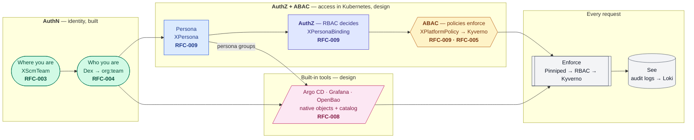
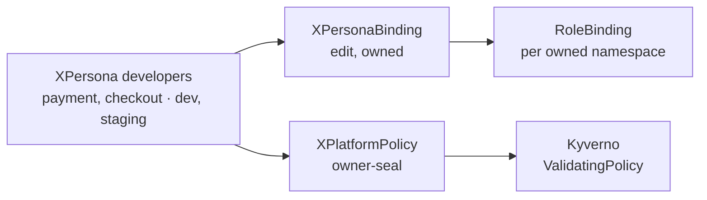
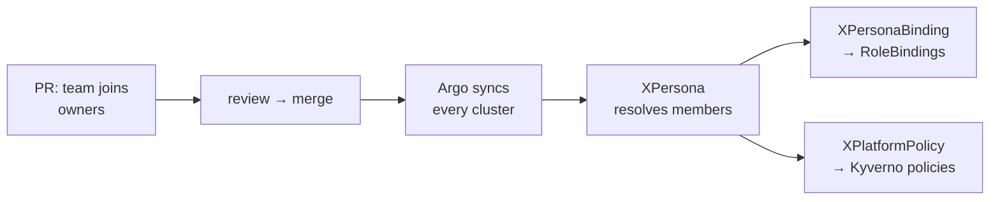
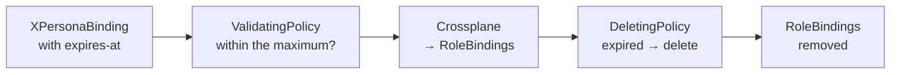

# Access Model — one SCM login, an SCM Persona, and everything it can reach

> [!NOTE]
> **Status: partly implemented.** The map that RFC-005, RFC-008 and [RFC-009](../rfc/009-scm-personas.md) each point at, so no single RFC has to
> restate the whole model. Identity is built ([RFC-003](../rfc/003-scm-connections-and-resources.md),
> [RFC-004](../rfc/004-dex-identity-and-portal-authentication.md)), and so are personas, bindings and Kubernetes guardrails (RFC-009, proven on a cluster
> 2026-11-04). Still design: projection into the platform tools (RFC-008), Core XR labelling (RFC-005), agents and audit. Written 2026-10-20 from a design
> discussion; revised 2026-10-24 when RFC-009 replaced the persona file and its CI compiler with three `auth.wxops.cloud` kinds — `XPersona`, `XPersonaBinding`,
> `XPlatformPolicy`.

---

## The principle

> **One login through your SCM. What its token says — who you are, which teams you are in — decides your SCM Persona. Your persona decides what you can
> reach: in Kubernetes, in every cluster, and in every platform tool.**

Nobody is granted access one person at a time. A person is in a Git team; the team has a persona; the persona has a fixed, reviewed meaning in every system.
Leaving the team in Git removes the access everywhere, at the next token.

### One login, not one token

"One token" means **one login, one identity, one set of claims** — not one bearer token replayed against every system. Dex issues a token per client
(audience), and Pinniped exchanges it for a credential valid for one cluster only, so a token leaked from Grafana does not open OpenBao or a cluster. Every
system sees the same `username` and `groups`; each in its own token.

---

## The layers



| Layer | Decides | Where it is written | Mechanism |
|---|---|---|---|
| Where you are | org and team | `XScmTeam` | OpenTofu Workspace against the SCM |
| Who you are | `username`, `groups` | the SCM itself, read at login | Dex connector |
| Your persona | who belongs, which environments | `XPersona` | Crossplane |
| Coarse RBAC | which kinds, where | `XPersonaBinding` | Crossplane → `RoleBinding`s; aggregation extends the roles |
| Guardrails | which objects | `XPlatformPolicy` | Crossplane → Kyverno CEL |
| Tools | the grant inside each tool | each tool's native objects | GitOps; `provider-vault` for OpenBao |
| Enforce | every request | each tool's own model | RBAC, OpenBao policy, Argo `policy.csv`, Grafana roles, Kyverno |
| See | what happened | logs | Loki (the API server audit log); `PolicyReport` not supported yet |

---

## The SCM Persona

```text
SCM Persona = the Git team you are in  ×  the persona that team was given  ×  the team's scope (owner, environments, clusters)
```

Three kinds, each an XR the platform writes ([RFC-009](../rfc/009-scm-personas.md)):



A team joins a persona by a label on its `XScmTeam` that only the platform may set. The team's slug is the scope: it is the `wxops.cloud/owner` value, the
namespace, the OpenBao prefix, the Argo project and the Grafana folder, so one string ties every system together and the matrix cannot explode — it is
*personas × roles*, written once, not *teams × namespaces × clusters*. The same XRs go to every cluster; each cluster's `wxops.cloud/environment` decides
whether a persona's bindings and rules render there.

Two of [RFC-005](../rfc/005-git-mapped-authorization.md)'s open questions close here:

- **The maintainer tier** — a `payment-maintainers` team simply joins the `owners` persona. No role has to travel in the claim, which matters because
  neither Dex connector puts one there.
- **The group format** — `<org>:<team>`, already what `XScmTeam.status.oidcGroup` publishes and `XOIDCConnector` emits.

**Keep the list short** — about three human personas and the agent ones. Per-team exceptions are how the matrix comes back; a new persona is a reviewed change,
not a convenience.

---

## Changing access is a pull request



No render step runs in CI and nothing but Argo writes to a cluster. *Who can do what* is answered by Kubernetes itself — `kubectl get clusterrole edit -o yaml`
for the aggregated rules, `kubectl auth can-i --list --as-group=wxops-idp:payment -n payment` for a team — and an effective-access report on the pull request
can come later as a check built on the same questions.

---

## Three verbs: generate, modify, check

| Verb | Who | Rule |
|---|---|---|
| **Generate** | Crossplane — Core compositions, bindings from `XPersonaBinding` only, and `provider-vault` for OpenBao; Kyverno for restrictions (below) | Declarative and convergent: it retries, and it can revoke |
| **Modify** | the compositions stamp `owner` and `environment` onto what they compose; Kyverno's one `MutatingPolicy`, `owner-stamp`, copies a namespace's owner onto new objects in it | A mutation copies a fact, never decides one — no other Kyverno defaulting |
| **Check** | RBAC grants; Kyverno narrows | Kyverno only ever denies. It cannot give access RBAC did not |

### What Kyverno may generate

| Kyverno generates | Allowed | Why |
|---|---|---|
| NetworkPolicy, ResourceQuota, LimitRange, Pod Security labels | allowed, **not the W'xOps way** | They only **narrow**; a bug makes a namespace stricter, not wider. But W'xOps bootstraps them from GitOps instead ([below](#namespace-defaults-come-from-gitops--decided-2026-11-08)) — an operator may still generate them |
| Any grant — a RoleBinding, a tool policy, an access object — derived or not | **no** | A grant is a decision; it belongs in Git as a reviewed diff, and bindings are `XPersonaBinding`'s ([RFC-009](../rfc/009-scm-personas.md)) |

**Why only narrowing objects:** W'xOps policies match people, never Kyverno's own service account, so nothing re-checks what Kyverno generates. A generated
object that can only make a namespace stricter is safe without that second check; a grant would not be.

### Namespace defaults come from GitOps — decided 2026-11-08

A tenant namespace's defaults — `ResourceQuota`, `LimitRange`, `NetworkPolicy` (default-deny, plus same-namespace, ingress controller and DNS) and registry
credentials — are bootstrapped **from the GitOps repository**: each team's `tenants/<name>/` directory, synced by its own `tenant-<name>` Application (an
Argo CD ApplicationSet with a git directory generator). The team's apps sync separately, per environment. Not composed by a Core kind, and not generated by a
Kyverno `GeneratingPolicy`.

- **Why:** bootstrapping a tenant is one directory, and changing its quota is one pull request — no policy logic to read, no Kyverno background controller
  with create rights in every namespace, no `synchronize` fighting a reviewed change.
- **Registry credentials stay out of Git:** an ESO `ExternalSecret` (`kubernetes.io/dockerconfigjson`) from OpenBao in `tenants/<name>/`, or one ESO
  `ClusterExternalSecret` selecting `auth.wxops.cloud/tenant-namespace: "true"` — never a Secret in the repository, as `secret-guard` expects.
- **The guardrails still hold:** the defaults carry `wxops.cloud/owner`; those labelled `wxops.cloud/protected: "true"` cannot be edited or deleted by
  people (`protected`), and Argo CD's `Prune=false` keeps a sync from removing them.
- **Core's part** in a tenant namespace stays identity, ownership and guardrails: the labels every rule trusts (`namespace-guard`), the bindings
  (`XPersonaBinding`) and the policies. How namespaces themselves are onboarded is the next release's golden-path work.

---

## Kubernetes: Pinniped → RBAC → Kyverno

The API server authenticates the request (Pinniped, trusting Dex) and fills `userInfo` — `username` and `groups` — before anything else runs. RBAC then grants
or refuses; only then does admission run, and every `AdmissionReview` Kyverno receives already carries `request.userInfo`. Nothing is passed from Dex to
Kyverno. `kubectl auth whoami` prints the exact strings a policy will match, prefix included.

| Request | Reaches admission (Kyverno)? | Who can restrict it |
|---|---|---|
| `get` / `list` / `watch` — including `kubectl logs` | **no** | RBAC only: namespace, resource, exact name |
| `create` / `update` / `patch` / `delete` | yes | RBAC + Kyverno |
| `connect` — `exec`, `attach`, `port-forward` | yes | RBAC + Kyverno |

So **reads stop at the namespace boundary**: a team reads its own namespaces, `Secret`s included under `edit` — accepted, because values come from OpenBao and
`secret-guard` keeps people from writing them. Writes, `exec` and `delete` are narrowed per object by comparing the object's `wxops.cloud/owner` with
`request.userInfo.groups`; on update both the old and the new owner must be the caller's, so nothing can be relabelled away from its team.

**Kyverno guards people, not the system:** SCM users today, AI agents (by their listed ServiceAccounts) later. Controllers, Crossplane and ESO answer to their
own RBAC, and Argo CD to its own projects, group-bound roles and merge review — Kyverno never matches their requests.

**Multi-cluster** — every cluster receives the same `XPersona`, `XPersonaBinding` and `XPlatformPolicy` XRs through Argo; its own Crossplane renders them
against a small per-cluster identity object (`env`, `cluster-name`, `role: hub|spoke`), defined with the multi-cluster feature
([RFC-009 open question 7](../rfc/009-scm-personas.md#open-questions)). The hub additionally runs the policies guarding Core XRs.

---

## Kyverno CEL — how far it reaches

Kyverno's CEL policy types (`policies.kyverno.io/v1`, all marked stable in Kyverno v1.19) replace `ClusterPolicy`, which is scheduled for removal in v1.20:
`ValidatingPolicy`, `MutatingPolicy`, `GeneratingPolicy` and `DeletingPolicy` (each with a namespaced twin). On top of Kubernetes' own CEL they add
[libraries](https://kyverno.io/docs/policy-types/cel-libraries/) that let a policy reach beyond the object it is looking at:

| Library | Functions | What it opens up here |
|---|---|---|
| `resource` | `resource.Get`, `resource.List`, `resource.Post` | Read any in-cluster object — the `XScmTeam` behind a group, the `XScmConnection`'s mirrored org members. `resource.Post` can run a live `SubjectAccessReview` |
| `http` | `http.Get`, `http.Post`, `http.Client(caBundle)` | Ask a third party for a fact at decision time: is this incident active, who is on call |
| `globalContext` | `globalContext.Get` | Read a `GlobalContextEntry` — an in-cluster or HTTP result Kyverno refreshes on an interval, so a slow third party makes data older, not admission slower |
| `time` | `time.now`, `time.truncate`, `time.toCron` + CEL `timestamp`/`duration` | Give any grant a lifetime and compare it to now |
| `x509`, `json`, `yaml`, `hash`, `random` | decoding and helpers | Certificates, structured annotations |

This is what keeps the model from being locked to one concept: any fact a third party holds can take part in a decision, and any derived grant can be given a
start and an end.

### Temporary access: checked, then terminated

Elevation is a time-bound `XPersonaBinding` ([RFC-009](../rfc/009-scm-personas.md#promotion)), reviewed in Git like any other binding:



**The split that keeps it safe: Kyverno checks and terminates the Kubernetes object; Crossplane makes every change it implies.** An admission check must be
free of side effects — the same request can arrive several times (retries, server-side dry-run, background scans), and another webhook can still deny it after
Kyverno allowed it — so a third-party write made from admission could belong to a request that never happened, with nothing to undo it. `http.Post` exists;
here it is not used to create anything.

A sketch — not yet run through `kyverno test`:

```yaml
# Termination: a binding carrying an expiry is deleted once it has passed.
apiVersion: policies.kyverno.io/v1
kind: DeletingPolicy
metadata:
  name: wxops-expire-bindings
spec:
  schedule: "* * * * *"                   # one minute is the finest granularity
  matchConstraints:
    resourceRules:
      - apiGroups: [auth.wxops.cloud]
        apiVersions: [v1alpha1]
        operations: ["*"]
        resources: [xpersonabindings]
  conditions:
    - name: expired
      expression: >-
        has(object.metadata.annotations) && 'wxops.cloud/expires-at' in object.metadata.annotations &&
        timestamp(object.metadata.annotations['wxops.cloud/expires-at']) < time.now()
```

What to hold to:

- **HTTP is allow-listed.** Start Kyverno with `--httpAllowlist` naming the few endpoints a policy may call, and leave HTTP in namespaced policies disabled
  (the default). A reported SSRF issue in the HTTP library concerned exactly the unrestricted case.
- **A third-party fact is a dependency.** With `failurePolicy: Fail` an outage of that party blocks the writes it guards; prefer a `GlobalContextEntry` for
  anything that changes slowly.
- **A lifetime ends twice.** Expiry is precise to the `DeletingPolicy` schedule, then to Crossplane's reconcile — a minute or two, not seconds.
- **Kyverno's controller needs `delete` on what it terminates** — `xpersonabindings`, nothing wider.

---

## Guardrail templates — built and next

RBAC answers *which kinds, where*; it cannot say *only your team's object*, *not if it is protected*, or *only this persona, only where its team owns*. Those
are the templates. Each is one reviewed KCL function in [`platform-policy`](../../docs/api-reference/auth/platform-policy.md), matches SCM users only, and denies —
it never grants. Free-form policies are not offered: [RFC-009](../rfc/009-scm-personas.md#open-questions) keeps it to templates.

**Built (2026-10-26; `sa-guard`, `namespace-guard` 2026-11-03), exercised by [`examples/auth/platform-policy/scenarios/`](../../examples/auth/platform-policy/scenarios):**

| Template | Protects |
|---|---|
| `owner-stamp` | An object created without an owner takes its namespace's `wxops.cloud/owner` — so `owner-seal` has something to check |
| `owner-seal` | Write, relabel and delete only what one of your teams owns — two teams share a namespace without harming each other |
| `secret-guard` | Secrets come from External Secrets Operator out of OpenBao, never by hand |
| `exec-guard` | `exec`, `attach`, `port-forward` only for one persona, only where its team owns — the doorway into a running workload's secrets |
| `protected` | Objects labelled `wxops.cloud/protected: "true"` change only by the exempt (platform) persona |
| `rbac-guard` | Bindings come only from `XPersonaBinding`; personas and policies only from the platform team |
| `sa-guard` | A workload runs only as `default` or a ServiceAccount its creator's team owns — with persona roles that drop `impersonate` and `serviceaccounts/token`, no one acts as another identity |
| `namespace-guard` | Namespaces, and their `wxops.cloud/owner` and `auth.wxops.cloud/tenant-namespace` labels, change only by the platform team — the labels every other rule trusts |

**Next, in this order:**

| Addition | Why |
|---|---|
| **A scope on every template — `namespaceSelector` built 2026-11-07**, later `environments` | Without one a policy is cluster-wide. A scope lets `exec-guard` run in `Deny` for production namespaces only (and in `Audit` elsewhere, once PolicyReports are supported); additive to the XRD, and `environments` waits on the cluster identity object ([multi-cluster](multi-cluster.md#open-decisions)) |
| **Break-glass — built 2026-11-06 as `temporaryExemptPersonaRef` (`until`), no template** | An exemption that expires (`until`, compared with Kyverno's `time.now()` inside each validation) instead of a permanent one — the policy-side twin of [temporary access](#temporary-access-checked-then-terminated) |
| **`env-gate` — built 2026-11-08, optional** | In namespaces whose `wxops.cloud/environment` is listed (say `prod`), only members of `personaRef` whose `environments` include it create, update, delete or exec; everyone else goes through Git. Per namespace — the per-cluster gate waits for multi-cluster |

**What a template brings with it:** its KCL function, golden cases, a row in the scenario kit, and an offline `kyverno test` case built from the same rows.
Workload rules — allowed registries, resource limits, pod security — are good Kyverno policies but not authorization, and stay out of `XPlatformPolicy` so the
kind keeps one meaning.

**Sources to check a new template against:**

- [`kubescape/cel-admission-library`](https://github.com/kubescape/cel-admission-library) — Kubescape controls as native `ValidatingAdmissionPolicy` CEL
- [`kubescape/regolibrary`](https://github.com/kubescape/regolibrary) — the same controls in Rego, scan-time, grouped into NSA, MITRE ATT&CK and CIS frameworks
- [ARMO controls hub](https://hub.armosec.io/docs/controls) — one page per control

---

## Third-party tools

Login is the same everywhere — one `XOIDCClient` per tool, the same Dex, the same `groups` claim. Authorization stays in each tool's **own native objects**,
which a tenant's `XWorkspace` renders from a platform `XWorkspaceClass` — one kind for every tool, none mirroring a tool
([RFC-008](../rfc/008-built-in-tools-identity-and-catalog.md), draft rewritten 2026-11-08):

| Tool | Login (bootstrap, once) | Group → permission | Written as |
|---|---|---|---|
| **Kubernetes** | Pinniped trusts Dex | `RoleBinding` to a `Group`, to a standard or `wxops:platform-*` role | `XPersonaBinding` (RFC-009) |
| **OpenBao** | `auth/oidc`, `groups_claim: groups` | external group + group alias (the Dex group string) + policy | `provider-vault` managed resources, rendered by `XWorkspace` |
| **Argo CD** | `oidc.config` pointing at the platform Dex | `AppProject.spec.roles[].groups`, one role per persona | native `AppProject` in Argo CD's namespace, rendered by `XWorkspace` |
| **Grafana** | `[auth.generic_oauth]` | org role through `role_attribute_path`; folder permissions | grafana-operator `GrafanaFolder`, rendered by `XWorkspace` |

Every one of those objects carries `wxops.cloud/owner` and `wxops.cloud/tool`, and the catalog lists them from the cluster and from Git — what exists, who owns
it, which persona reaches it — without writing anything back.

---

## AI agents

Agents are `XPersona` members — their ServiceAccounts — never a special case:

| Task | Bindings | Rule |
|---|---|---|
| Audit | `wxops:persona-viewers` + a role for `policyreports` | Policy reports and audit logs; no secret values |
| Debug | `wxops:persona-viewers` + a `wxops:*` role for `pods/log` and events | Events, logs and status across clusters; no `secrets`, no `exec`, no writes |
| Deploy | **no Kubernetes write at all** | An SCM bot identity, a member of an `XScmTeam`, that opens pull requests — the same gate, review and audit trail as a person |

`rbac-guard` refuses any binding not written through `XPersonaBinding`, so widening an agent is a reviewed change to its persona, not a binding slipped in beside it.

### Data boundary and audit

- **An agent is a principal.** Its own identity, its own persona, every action in the same audit pipeline as a person's — "the AI did it" resolves to a name
  in a log.
- **Metadata and payloads are different boundaries.** Statuses, events, manifests and docs may reach any model the platform approves. Payloads — logs with
  user data, traffic, a [Darlane session](darlane.md#session-safety--tools-audit-data-boundary)'s contents — are read only by **in-cluster inference**; an
  external model API is an exfiltration path.
- **Advisory by default.** Findings and diagnoses accelerate a human decision; they are not the decision.
- **Auto-remediation stays gated.** An agent applying its own change is a different trust decision from an agent opening a pull request, and it is not on the
  table until session and agent audit exist.

---

## Audit

Every layer already records the identity; ship them to one place and join on `username` and `groups`:

- Dex and Pinniped — who logged in, with which groups, when;
- the Kubernetes API server audit log — what they did, in which cluster; through Pinniped's impersonation proxy the person is in `impersonatedUser`;
- the OpenBao audit device — which paths they read;
- Argo CD and Grafana — syncs and changes;
- Kyverno `PolicyReport`s — every rule result in one API, also what an agent reads to explain why something was blocked. **Not supported yet**: the
  controller writes back through the API server, so they return with the events-and-audit agent work, and `Audit` with them
  ([RFC-009 open question 9](../rfc/009-scm-personas.md#open-questions)).

---

## The label foundation

Every Kyverno rule above trusts a label. Today ([inventory](#appendix--labels-and-annotations-in-the-packages-today)) only `wxops.cloud/owner` carries
authorization meaning, and it is not yet trustworthy:

1. **`owner` is a convention.** Required by nothing, immutable by nothing, read by no composition.
2. **It never reaches workloads.** `tenant-app` stamps `environment` and `app-flavor` onto what it composes, not `owner`, so there is nothing on a pod to compare
   with the caller's groups.
3. **It can be forged.** `XTenantApp.spec.parameters.labels` flows into pod labels; the composition's own `wxops.cloud/*` keys win only where it sets them.
   The KCL must set `owner` itself, and a policy must reject any `wxops.cloud/*` key in `spec.parameters.labels`.
4. **`scm.wxops.cloud/oidc-login` is a login gate** writable by anyone who can write an `XScmTeam`. It, and the persona membership labels, are platform-only.

Fixing these comes **first** — before any policy enforces.

| Label | Kyverno checks | Reaches |
|---|---|---|
| `wxops.cloud/owner` | stamped from the namespace (`owner-stamp`), sealed (`owner-seal`), the writer is in `<org>:<owner>` | namespace, OpenBao `tenants/<owner>/`, Argo project, Grafana folder |
| `wxops.cloud/environment` | prod changes need a persona that includes prod | Argo destinations, OpenBao capabilities |
| `scm.wxops.cloud/oidc-login` | platform-only | which teams reach the `groups` claim — every tool's login |
| `auth.wxops.cloud/persona-<name>` | platform-only, on `XScmTeam` | membership of an `XPersona` |
| `wxops.cloud/protected` | members of a persona cannot update or delete (`protected`) | shared objects inside a team's namespace |
| `wxops.cloud/expires-at` | a valid timestamp within the persona's maximum | the `DeletingPolicy` that ends it |

---

## Mediated or projected

[OpenChoreo](https://openchoreo.dev/docs/next/platform-engineer-guide/authorization/overview/) answers the same question the other way: roles and bindings as
CRDs, evaluated by its own API with Apache Casbin, in front of everything users reach. W'xOps projects one definition into each tool's own enforcement.

| | Mediated (OpenChoreo) | Projected (W'xOps) |
|---|---|---|
| Enforcement | one decision point, its API | every system's own |
| How people reach tools | through that API, UI, CLI and MCP | directly: `kubectl`, Grafana, `bao`, Argo |
| Filtering reads | yes, at component level | Kubernetes reads stop at the namespace |
| "Can X do Y?" | ask the enforcer | ask Kubernetes (`kubectl auth can-i`), per tool |
| Revocation | at once | after convergence |
| A tool's full feature set | only what the API exposes | all of it |

W'xOps's users and agents work in the Kubernetes ecosystem directly, across clusters, so projection fits. The two are not exclusive: Argo CD's `policy.csv`
already *is* Casbin, and the Portal can later be a mediated door for developers — its policy one more consumer of the same personas.

**Projection has a long precedent.** [Apache Ranger](https://ranger.apache.org/) has run the same split for a decade across data platforms: policies are
authored once in a central admin, and plugins inside each service pull them and enforce natively — the admin is never on the request path. W'xOps differs in
where the central copy lives (Git, reviewed as a diff, not a database) and in rendering into each tool's *own* grant objects instead of shipping a plugin into
it.

### Keeping it lightweight

The model adds **no running component**: Dex, Pinniped, Crossplane, Kyverno and Argo CD already run, and the only new code is three `auth.wxops.cloud`
packages. Four rules keep it that way:

1. **No new running component** without an RFC showing those four cannot do the job.
2. **No per-team exceptions.** A need that does not fit a persona becomes a new, reviewed persona — or nothing.
3. **Borrow standards, not services.** If a decision service is ever justified — the Portal's own decisions, or [OpenFGA](https://openfga.dev/) (CNCF
   incubating) answering explain queries — it speaks [OpenID AuthZEN](https://openid.net/specs/authorization-api-1_0-final.html), so it stays optional and
   replaceable.
4. **Kyverno denies**, mutates only to copy a namespace's owner, and generates only objects that narrow — never a grant; Crossplane makes
   every third-party write and every binding.

### Kyverno alone, or behind `XPlatformPolicy`

Kyverno enforces on its own; the layer above it is about where a policy's inputs come from and how a change to them is tested and delivered.

| | Kyverno alone | Behind `XPlatformPolicy` |
|---|---|---|
| Who is an SCM user, who is exempt | Group lists hand-written into each policy's CEL, edited as teams change | Resolved from `XScmTeam` and `XPersona`, rendered in — a team joining is a label, not a policy edit |
| What a rule may say | Any CEL, per author | Reviewed templates with parameters; one definition of *SCM user* and *owner* |
| Tested by | Whatever each author writes | Golden renders, invariants, the scenario kit |
| Relation to RBAC | Separate files, separate reviews | The same group and inputs as `XPersonaBinding` |
| Status | Kyverno's own | `created`/`ready`/`synced`, like every W'xOps kind |

A static policy could instead read an `XPersona` at admission time through Kyverno's `resource.Get` — no propagation delay, but an API read on every request
and a policy no longer reviewable as a whole. Rendering is kept.

### Related projects

Most of these are authorization or tenancy; on authentication W'xOps composes Dex and Pinniped rather than competing. Checked 2026-10-28.

| Project | What it is | Against W'xOps |
|---|---|---|
| [Capsule](https://projectcapsule.dev/) — CNCF Sandbox (accepted 2022) | A `Tenant` kind: owners (users, groups, ServiceAccounts) get `admin` over the tenant's namespaces, plus quotas and allowed classes and registries, enforced by its own controller and webhook | The closest overlap. Its tenants are declared by hand; W'xOps derives owners from SCM membership. Running both makes two owners of *tenant* |
| [rbac-manager](https://github.com/FairwindsOps/rbac-manager) (Fairwinds) | `RBACDefinition` → `RoleBinding`s and `ClusterRoleBinding`s | `XPersonaBinding`'s job, without personas or guardrails |
| [HNC](https://github.com/kubernetes-retired/hierarchical-namespaces) — **archived April 2025** (`kubernetes-retired`) | Namespace trees passing RBAC and objects down | A different shape — a tree instead of an owner label — and no longer maintained |
| [vcluster](https://www.vcluster.com/) | A virtual control plane per tenant | Stronger isolation (its own API server); for a tenant that needs cluster-admin of its own |
| [Gatekeeper](https://open-policy-agent.github.io/gatekeeper/website/), [Kubewarden](https://www.kubewarden.io/) | Other policy engines | Alternatives to Kyverno; the templates would port |
| [ValidatingAdmissionPolicy](https://kubernetes.io/docs/reference/access-authn-authz/validating-admission-policy/) — GA in Kubernetes 1.30; MutatingAdmissionPolicy beta in 1.34 | CEL policies evaluated inside the API server, no webhook | Kyverno can generate one from a `ValidatingPolicy` (`spec.autogen.validatingAdmissionPolicy`) — the way to drop Kyverno from the request path; an open decision below |
| [Teleport](https://goteleport.com/) | Access proxy: single sign-on, just-in-time access requests, session recording | Strong where W'xOps is thin — just-in-time access and audit — but a whole access platform on the request path |
| [OpenFGA](https://openfga.dev/) — CNCF Incubating (2025), [SpiceDB](https://github.com/authzed/spicedb) | Relationship-based authorization | Expressive, but needs an authorization webhook and its own copy of the relationships; only behind AuthZEN (rule 3 above) |

### Relationship-based access — above Kubernetes, never in it

ReBAC (OpenFGA, SpiceDB) answers questions labels cannot carry far: many-to-many sharing between teams and apps, inheritance from org to team to app to
environment, *why* someone holds a grant. It has three possible places, and only one fits:

| Where | How | Fit |
|---|---|---|
| Kubernetes decides through it | An authorization webhook, or Kyverno's `http`/`globalContext`, asks *can X do Y on Z?* per request | No — a new engine on every request path, and an availability dependency for all of them ([what W'xOps does not build](#what-wxops-does-not-build)) |
| It is the source; a controller expands it into bindings | Relationships live in the store; a custom controller turns them into personas and `RoleBinding`s | No — a second distribution mechanism beside Crossplane, which cannot do the expansion itself: compositions read Kubernetes objects, never call out |
| **The Portal or a platform API decides through it; Crossplane feeds it** | Personas and teams stay the source. Crossplane writes them into the store as relationship tuples, like any projected tool; the Portal asks it for its own decisions and explanations, over AuthZEN | **Yes, when needed** — Kubernetes keeps RBAC and Kyverno, and Crossplane stays the one place access is distributed from |

The feed is available off the shelf: the [OpenFGA Terraform provider](https://pkg.go.dev/github.com/openfga/terraform-provider-openfga) (`openfga/openfga`)
manages authorization models and relationship tuples, so provider-opentofu can run it — the store itself must exist first; the provider does not create it.
[SpiceDB has an official Kubernetes operator](https://authzed.com/docs/spicedb/getting-started/install/kubernetes) for running it, but only a community Terraform provider for its relationships (checked 2026-10-28).

Not yet: the gaps it would close today — a maintainers team, a guest team — close with a label and a persona ([open decisions](#open-decisions) 6). It becomes
worth a store when sharing outgrows labels, or the Portal must explain every grant.

---

## What W'xOps does not build

- No authorization engine on the request path — each system enforces its own grants.
- No grants created per login — there is no login hook to drive it, and short-lived tokens already make access temporary.
- No third-party writes from admission — Kyverno decides, Crossplane writes.
- No Crossplane Operations as owners of tool configuration while they are alpha and cannot delete.
- No W'xOps kind per tool — Argo CD, Grafana and OpenBao are configured on their own native objects (`provider-vault` for OpenBao), never wrapped.
- No role mapping inside the identity provider — Dex stays thin; the mapping is Git.
- No composition-emitted RBAC beyond `XPersonaBinding`'s bindings — never a `Role` or `ClusterRole`, never `cluster-admin`, `bind` restricted by `resourceNames`
  ([RFC-009](../rfc/009-scm-personas.md#the-narrow-change-to-no-rbac-in-compositions); an ADR on acceptance).

---

## Known limits

- **Claims are a login-time snapshot.** Leaving a Git team takes effect at the next token; token lifetimes are the lever.
- **Kubernetes reads stop at the namespace.** Admission never sees `get`, `list`, `watch` or `logs`; Core XRs are readable cluster-wide under `wxops:platform-view`.
- **Access converges, it is not instant** — Argo sync, Crossplane reconcile, `DeletingPolicy` schedule.
- **Separate on writes, shared on reads.** Two teams in one namespace cannot change each other's objects, but read everything their role allows; a person in
  both teams owns both. A guest team must label its objects with its own owner — unlabelled, they take the namespace's owner and are refused.
- **Gitea team names keep their case** (`wxops:Owners`) while GitHub groups are slugs, and RBAC matches groups exactly — the choices are
  [RFC-005 open question 11](../rfc/005-git-mapped-authorization.md#open-questions).

---

## Open decisions

1. **Kubernetes RBAC: GitOps or Crossplane? — decided 2026-10-24:** Crossplane, bindings only, through `XPersonaBinding`; roles stay static manifests
   ([RFC-009](../rfc/009-scm-personas.md)). An ADR records it on acceptance.
2. **Namespaced XRs — decided 2026-10-24:** Core kinds stay cluster-scoped, sealed by owner ([RFC-005](../rfc/005-git-mapped-authorization.md#open-questions)).
3. **Token lifetimes** — [RFC-005 open question 8](../rfc/005-git-mapped-authorization.md#open-questions).
4. **Grafana per-team access** — [RFC-008 open question 4](../rfc/008-built-in-tools-identity-and-catalog.md#open-questions); `XWorkspace` renders the
   folder, and how far open source Grafana's per-team permissions go is the spike.
5. **Elevation** — a time-bound `XPersonaBinding`; its maximum lifetime and who approves are [RFC-009](../rfc/009-scm-personas.md#rollout-plan)'s *Later*.
6. **A second team on one owner — settled 2026-11-07** ([ADR-006](../adr/006-team-owner-mapping.md)). A team owns its slug plus the owner its `XScmTeam`'s
   `wxops.cloud/owner` label names: `payment-maintainers` labelled `payment` owns what `payment` owns — under `scope: owned`, `owner-seal`, `exec-guard` and
   `sa-guard` alike.
7. **Reads are not sealed — narrowed 2026-11-03.** Team personas now read through `view`, which has no Secrets; only `platform` (`admin`) reads Secret
   values. ConfigMaps stay readable, so credentials belong in OpenBao, not ConfigMaps.
8. **Namespaces Kyverno skips — settled 2026-11-04.** Kyverno adds a namespace selector to every policy webhook, skipping `kube-system` and `kyverno`
   (checked on the cluster): no W'xOps policy runs there. Accepted — no team persona holds RBAC in those namespaces; only `platform` does, and it is trusted.
9. **Native admission policies — deferred 2026-11-04.** Kyverno only, run in high availability; a graceful Kyverno shutdown leaving a short unchecked window
   is answered by HA and by a Kyverno-required guard instead ([RFC-009 results](../rfc/009-scm-personas.md#spike-and-acceptance-results-2026-11-04)).
   Both are bootstrap setup — Kyverno is installed before W'xOps, so its replicas, PodDisruptionBudget and the optional guard are the operator's, noted in
   [setup](../../docs/user-guide/setup.md); no W'xOps package ships or waits on them (2026-11-06). HA follows Kyverno's
   [High Availability guide](https://kyverno.io/docs/guides/high-availability/): at least three admission-controller replicas, the minimum it supports
   ([RFC-009](../rfc/009-scm-personas.md#spike-and-acceptance-results-2026-11-04) has the details).
10. **Capsule or not.** Decide once, explicitly, that W'xOps's personas own the tenant concept — so Capsule is not added beside it later.
11. **Relationship-based access for the Portal.** Whether the Portal or a platform API gets an OpenFGA store, fed by Crossplane, for its own decisions — never
    for Kubernetes ([above](#relationship-based-access--above-kubernetes-never-in-it)).
12. **System groups as persona members — closed 2026-11-04.** The `XPersona` XRD refuses any `system:` value in `members.groups` and `members.users`, so
    `system:authenticated` or `system:masters` can never be bound or exempted by mistake. Kubernetes' own identities are otherwise left alone: no template
    matches them, and a ServiceAccount joins a persona only by name, through `members.serviceAccounts`.
13. **Acting as a ServiceAccount — closed 2026-11-03.** The built-in `edit`, and so `admin`, let a person impersonate any ServiceAccount in the namespace
    and request its tokens, arriving as `system:serviceaccount:…` where no template matches. Team persona roles are now `view` plus W'xOps write pieces —
    no `impersonate`, no `serviceaccounts/token`, no ServiceAccount, Secret, Pod or RoleBinding writes — and `sa-guard` stops a workload running as another
    team's ServiceAccount. Only `platform` keeps `admin`, and the audit log records its use ([RFC-009](../rfc/009-scm-personas.md#persona-roles-built-from-wxops-pieces-not-editadmin--built-2026-11-03)).
14. **PolicyReports and `Audit` — settled 2026-11-06: `Deny` by default, PolicyReports not supported yet.** Validating templates run in `Deny` with
    `failurePolicy: Fail`; the API server audit log is the record. `mode: Audit` stays in the API, but it has an effect only where Kyverno's reports
    controller runs, and W'xOps runs none — the controller writes back through the API server and has been seen throttling CPU on v1.19. `Audit` returns
    with the work that reads Kubernetes events, PolicyReports and the audit log through AI agents
    ([RFC-009 decision](../rfc/009-scm-personas.md#deny-by-default-audit-by-choice--decided-2026-11-06)).
15. **Namespace defaults — settled 2026-11-08: from GitOps.** Quota, limits, network policy and registry credentials live in the team's `tenants/<name>/`
    directory, synced by its `tenant-<name>` Application — not a Core composition and not a Kyverno `GeneratingPolicy`
    ([above](#namespace-defaults-come-from-gitops--decided-2026-11-08)).

---

## Where it lands

| Part | Document | State |
|---|---|---|
| This map | `core-ideas/access-model.md` | this file |
| Where you are | [RFC-003](../rfc/003-scm-connections-and-resources.md) | implemented |
| Who you are | [RFC-004](../rfc/004-dex-identity-and-portal-authentication.md) | implemented |
| Built-in tools | [RFC-008](../rfc/008-built-in-tools-identity-and-catalog.md) — one login, a tenant `XWorkspace` rendering each tool's native objects from a platform `XWorkspaceClass`, a catalog; `provider-vault` for OpenBao | draft, rewritten 2026-11-08 |
| Personas, bindings, guardrails | [RFC-009](../rfc/009-scm-personas.md) — `XPersona`, `XPersonaBinding`, `XPlatformPolicy`, aggregation, agents, audit | draft, rewritten |
| Core XR ownership | [RFC-005](../rfc/005-git-mapped-authorization.md), narrowed — the owner label on Core XRs, the three writers, its rules as `XPlatformPolicy` templates | draft |

**Spikes — Kubernetes ones run 2026-11-04** ([results](../rfc/009-scm-personas.md#spike-and-acceptance-results-2026-11-04)): identity through Pinniped's
impersonation proxy into Kyverno ✓, provider-kubernetes binding with only `bind` ✓, Kyverno unavailable (a short unchecked window on graceful shutdown —
answered by HA, part of the operator's Kyverno setup). Still open: Grafana open source group-to-team mapping. Pinniped is installed (bootstrap), and OpenBao OIDC login with an external group alias matching `org:team` is verified (RFC-008).

**Then:** `XPersona` ✓ → `XPersonaBinding` ✓ → `XPlatformPolicy` ✓ (proven in `Deny`) → `XPolicy` with `Deny` by default and scope per template →
OpenBao on `provider-vault` → Argo CD's default projects → Grafana → the catalog.

---

## Appendix — labels and annotations in the packages today

| Key | On | Purpose |
|---|---|---|
| `wxops.cloud/owner` | XRs (examples, READMEs) | ownership — convention only, see [the label foundation](#the-label-foundation) |
| `scm.wxops.cloud/oidc-login` | `XScmTeam` | opt the team into `XOIDCConnector`'s generated allow-list |
| `wxops.cloud/managed-by: platform-database-clusters` | `XPlatformDatabaseCluster` | `tenant-database` pool discovery |
| `wxops.cloud/tenant-database` | `XTenantDatabase` (stamped by its KCL) | per-pool database count |
| `crossplane.io/composite` | every XR (stamped by Crossplane) | `oidc-*` packages look up a referenced XR by name |
| `wxops.cloud/environment`, `wxops.cloud/app-flavor` | `tenant-app` workloads | classification |
| `app.kubernetes.io/{name,instance,component,managed-by}` | `tenant-app` workloads | selectors and conventions |
| `wxops.cloud/darlane-ttl` (annotation) | Darlane Deployment | lifetime — still stamped, **not enforced** (expiry dropped 2026-10-22; the old policy is removed) |
| `wxops.cloud/template-id`, `wxops.cloud/repo-url` (annotations) | `tenant-app` resources | catalog links |
| `auth.wxops.cloud/generation`, `auth.wxops.cloud/callback-url` | `oidc-*` internals | rotation trigger; status round-trip — not for policy |
| `crossplane.io/composition-resource-name`, `krm.kcl.dev/ready`, `channel` | compositions | Crossplane plumbing — not for policy |
