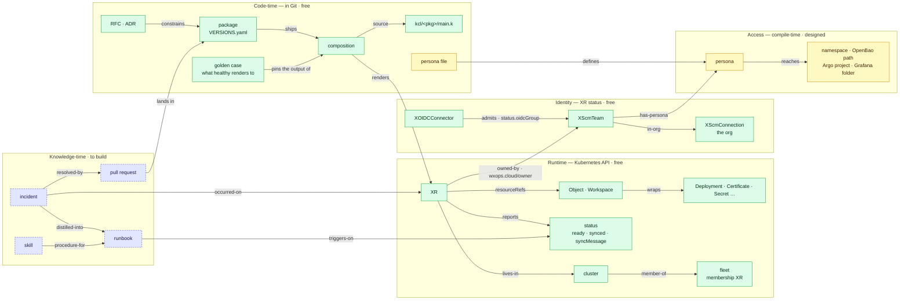

# Knowledge Architecture — what the SRE Agent knows, and how it gets written down

> **Status: research + direction, not implemented.** Companion to [`self-service-operations.md`](self-service-operations.md): that document defines the pillars
> (signals → runbooks → intelligence); this one goes a level deeper into the substrate the intelligence stands on — **how operational knowledge is captured,
> structured, and fed to both humans and the SRE agent** so that troubleshooting effort actually leaves the infra team instead of being re-derived every
> incident. It covers the document taxonomy (RFC · ADR · runbook · reference), knowledge representations for agents (RAG, knowledge graphs, Skills, memory), the
> architecture around the agent, and the concrete mindmap for Darlane's SRE agent.

---

## The story: agents compound whatever is written down — including nothing

The infra-team bottleneck is, at root, a **knowledge locality problem**. The diagnosis for "cert not issuing" or "shared pool exhausted" exists — in one
engineer's head, in a Slack thread from March, in a half-remembered incident. Every troubleshooting request is a query against knowledge that was never written
down, so every query routes to the people who hold it.

Adding an SRE agent to this situation does not fix it. **An agent is an amplifier on captured knowledge**: grounded on good runbooks and real topology it
compresses hours to minutes; grounded on nothing it hallucinates plausible diagnoses with confidence, which is *worse* than a ticket queue. The 2026 field data
is consistent — AI-assisted incident response saves hours per incident *where the knowledge substrate exists*, and the substrate is the differentiator between
tools, not the model.

So the actual project is a loop, and the agent is only one arc of it:

```
            ┌──────────────────────────────────────────────┐
            ▼                                              │
   incident occurs                                         │
        │                                                  │
   diagnose (human or agent, using existing knowledge)     │
        │                                                  │
   resolve (PR through the gate)                           │
        │                                                  │
   CAPTURE ── post-mortem / incident note                  │  the arc most
        │                                                  │  teams skip —
   DISTILL ── runbook updated, skill updated,              │  and the only
        │      ADR if a decision was made                  │  one that
        │                                                  │  compounds
   GROUND ── agent + docs site pick up the change ─────────┘
```

**The loop's failure mode is skipping capture and distill** — resolving the incident and moving on. Then the next identical incident costs the same, the agent
stays ignorant, and the bottleneck is intact regardless of how much tooling surrounds it. Everything below is in service of making capture and distill cheap
enough that they actually happen.

---

## The document taxonomy — four jobs, four lifetimes

"Documentation" fails as one bucket because it holds artifacts with opposite lifecycles. Four types, each with a distinct job, mutability, and reader:

| Type | Job | Mutability | Primary reader | Anti-pattern it prevents |
|---|---|---|---|---|
| **RFC** (request for comments) | Propose and argue a change *before* it happens; capture the option space | Living until decided, then frozen as history | Humans deciding | Decisions made in DMs; option space re-derived per debate |
| **ADR** (architecture decision record) | Record one decision: context → decision → consequences. Immutable once accepted; superseded, never edited | **Immutable** (append-only chain) | Humans *and agents* asking "why is it like this?" | Re-litigating settled decisions; agents "fixing" deliberate choices |
| **Runbook** | Get a specific failure from signal to resolution; every step executable by its reader | Living, verified against reality on a cadence | On-call humans and the agent, mid-incident | Diagnosis knowledge locked in heads |
| **Reference / explanation** (Diátaxis: reference, how-to, tutorial, explanation) | What the system *is* and how to use it | Living, versioned with the code | Everyone, calm-time | Tribal onboarding |

Post-mortems are the fifth artifact — not a document *type* so much as the **raw input** the loop distills into the other four: a post-mortem that changes no
runbook, records no ADR, and updates no reference was written for ceremony.

### What W'xOps already has, mapped honestly

The repo is further along this taxonomy than most — largely by accident of discipline — and seeing the mapping tells you exactly what's missing:

| Taxonomy slot | Existing artifact | Gap |
|---|---|---|
| RFC | [`development-docs/rfc/`](../rfc/README.md) — one file per proposal (RFC-002 to 008), argued before it is built; the index's `Status` column is the record of what's next. Intake through the RFC issue template (`.github/ISSUE_TEMPLATE/rfc.md`) | Machine-readable tags — status and affected kinds — so an agent can ask *which RFC touches `XScmTeam`* without reading prose |
| ADR | [`development-docs/adr/`](../adr/README.md) — one committed file per decision of lasting consequence (ADR-001 to 004); a rejection is recorded in the RFC or ADR it belongs to. The archived [`ROADMAP.md`](../_archives/ROADMAP.md) keeps the older *Decided and rejected* table as history | The same tags, so *what constrains this package* is a lookup, not a search |
| Runbook | None yet — planned as the "Failure modes" sections ([`self-service-operations.md`](self-service-operations.md) Pillar 2) | The whole slot; format proposed below |
| Reference | [`status-contract.md`](../../docs/api-reference/status-contract.md), per-package docs, [`tests/README.md`](../../tests/README.md) | Healthy — Phase 0 built this deliberately |
| Explanation | [`darlane.md`](darlane.md), [`access-model.md`](access-model.md), [`observability.md`](observability.md), [`multi-cluster.md`](multi-cluster.md) | Healthy |
| Post-mortem | Nothing — no incident record convention | `docs/incidents/` with a template; the loop's input arc |
| **Agent-facing operational memory** | `CLAUDE.md` — procedural knowledge written *for an agent*: conventions, gotchas (`_get`/Undefined, `crossplane render` vs `beta render`), the working model. Plus `tests/` as a machine-checkable behavioural spec | This is the embryo of the Skills layer below — currently one monolithic file rather than progressively-disclosed units |

That last row deserves emphasis: **`CLAUDE.md` is proof the pattern already works here.** It is operational knowledge, captured once, that changes agent
behaviour every session — the exact mechanism the SRE agent needs, at platform-operations scope instead of repo-contribution scope.

### Runbook anatomy — the format worth standardizing

For a runbook to serve humans *and* the agent, structure beats prose. Machine-readable frontmatter, then steps:

```markdown
---
id: rb-tenant-app-cert-pending
kind: XTenantApp
trigger:                       # the status shape that selects this runbook
  status: { ready: true, dependenciesReady: false }
severity: warning              # page vs ticket vs FYI
rbac: tenant-developer         # every command below runs with THIS role
owner: platform-team
last_verified: 2026-08-22      # against which package version
supersedes: []
---

## Symptom      — what the reporter sees (portal card, alert text)
## Verify       — one command proving you're in THIS failure, not a lookalike
## Diagnose     — ordered checks, most-likely first, each with expected output
## Fix          — the change, expressed as XR field / PR — never raw kubectl apply
## Verify fixed — the status flip to watch for
## Escalate     — evidence bundle for infra (XR name, notReady, events) —
##                legitimate only if the fix required platform-side access
```

The `trigger` block is what makes the collection *indexable by the status contract* — the portal (or agent) resolves `notReady` + status shape to a runbook
mechanically, no search step. `last_verified` is the honesty field: [`self-service-operations.md`](self-service-operations.md)'s stale-docs warning applies
double to runbooks, because a wrong runbook mid-incident costs more than none.

---

## Knowledge representations for the agent — four forms, one budget

Human docs and agent knowledge overlap but are not identical. Four representations, in ascending structure:

### 1. Prose + retrieval (RAG) — the floor

Vector search over the docs corpus. Cheap to stand up, and genuinely useful for *explanation*-type knowledge ("why does W'xOps not emit RBAC?"). Its known
failure: retrieval returns chunks, and chunks lose **relations** — the fact that *this* XR composes *that* Object which depends on *that* ClusterIssuer is
exactly what a chunk boundary destroys. RAG alone produces agents that know facts but not the system.

### 2. The knowledge graph — and the half W'xOps gets free

The 2026 pattern for SRE agents is grounding on a graph: entities (services, clusters, teams, incidents, decisions) and typed edges (composed-of, depends-on,
runs-on, owned-by, caused-by, fixed-by, documented-in), traversed at diagnosis time — GraphRAG for root-cause analysis over *actual topology* rather than
telemetry correlation.

The observation this document exists to make: **the expensive half of that graph — live topology — is what Crossplane already maintains.**



Green is free today, yellow is designed, dashed blue is the actual project. Two edges carry most of the value: `owned-by` ties every runtime object to a Git
team, so the same walk answers *who owns this* for diagnosis and *who can reach this* for the [access model](access-model.md); and `pr → package` closes
the loop, so every fix re-enters the graph through the same reviewed path it came from.

The workflow that walks it — the same for an on-call human and an SRE agent:

```mermaid
flowchart LR
    A["alert · portal card"] --> S["XR status<br/>synced=false · syncMessage"]
    S --> T["tree walk<br/>resourceRefs → Object → events"]
    T --> R["runbook<br/>matched by its trigger"]
    R --> H["incident history<br/>same XR, same shape"]
    H --> F["fix in the Darlane twin<br/>validated on mirrored traffic"]
    F --> P["pull request<br/>+ evidence"]
    P --> G["pr-validate<br/>goldens · invariants"]
    G --> M["human merge<br/>→ Argo → cluster"]
    M --> D["post-mortem<br/>distilled into runbook · skill"]
    D -.->|"next time, one hop shorter"| R

    classDef free fill:#dcfce7,stroke:#16a34a,color:#052e16
    classDef tobuild fill:#e0e7ff,stroke:#4f46e5,color:#1e1b4b,stroke-dasharray:4 3
    class A,S,T,P,G,M free
    class R,H,F,D tobuild
```



The build order falls out: **don't start by building a graph database.** Start by making the knowledge-time artifacts exist with stable IDs and typed
frontmatter (the runbook `trigger`, ADR numbers, incident records referencing XRs by name) — the graph is then a projection over git + the Kubernetes API,
buildable when an agent needs multi-hop traversal, not before.

### 3. Skills — procedural knowledge as the open standard

Agent Skills (the SKILL.md standard, released December 2025 and since adopted across Claude, Codex, Gemini CLI, Copilot) is the missing format for *procedural*
knowledge: a folder per capability, YAML frontmatter with name + description, instructions and optional scripts inside, loaded by **progressive disclosure** —
agents see only names/descriptions until a task matches, then load the full skill.

This matters for the SRE agent for a budget reason, not a fashion reason: an agent grounded on "all the docs" drowns its context window in calm-time explanation
while mid-incident. Skills invert that — the agent carries an index of *what it knows how to do* and pays context only for the procedure it is executing.
Runbooks and skills converge here: **a runbook is the human-rendered view, a skill is the agent-executable view, and with structured frontmatter they can be
generated from the same source.**

### 4. Memory — the three tiers, mapped

Agent-memory literature splits memory into episodic / semantic / procedural. The mapping onto this architecture is exact, which is a good sign the taxonomy is
right:

| Memory tier | Content | W'xOps artifact |
|---|---|---|
| **Episodic** — what happened | Incident records, post-mortems, past diagnosis sessions | `docs/incidents/` (to create) |
| **Semantic** — what is true | Status contract, package reference, ADRs, topology | Exists (docs + ADR gap) + runtime graph |
| **Procedural** — how to act | Runbooks, skills, CLAUDE.md conventions | Runbook/skill layer (to create) |

---

## Architecture around the agent

The self-service-operations doc set the guardrails (read-only, in-cluster inference for payload-touching work, agent-as-principal, PR-only writes). The
knowledge view adds four architectural rules:

**Context engineering over model choice.** The agent's quality tracks what reaches its window: skill index + triggered runbook + the *walked* subgraph (this
XR's tree, not the fleet) + relevant ADRs. Progressive disclosure at every layer; never "the docs" wholesale.

**Tools are knowledge too.** MCP servers (kubectl read-only, Prometheus, Loki, git, the docs site) define what the agent can *observe*; skills define what it
*knows how to do*; the two compose — a skill's steps invoke the toolset. Keeping tools read-only keeps the entire knowledge layer side-effect-free; the single
write path stays the PR.

**Tier the corpus by data sensitivity.** Metadata (statuses, events, manifests, docs) is one boundary; payloads (logs with user data, traffic) are the
in-cluster-only boundary ([access model](access-model.md#data-boundary-and-audit)). The knowledge architecture must tag which tier each source belongs to *before* an agent is wired, because retrofitting a data boundary
onto a working agent never happens.

**Evaluate with golden incidents.** The repo's deepest habit — golden render tests as a behavioural spec — has an exact operational analogue: **replay past
incidents as an eval set.** Each distilled incident becomes a fixture (initial status + events + logs excerpt → expected diagnosis + expected runbook
selection); an agent or prompt change runs the suite before it ships. This is the same discipline as `make test`, pointed at the ops layer — and it is what
turns "the agent seems better" into a diff you can read.

---

## The Darlane SRE-agent mindmap

The concrete skill tree for [`darlane.md`](darlane.md)'s SRE agent — each node a skill folder in the standard format, each mapping to platform capabilities that
already exist or are already specified:

```
sre-agent/
├── triage-xr/               entry point — walk status → notReady → Objects →
│                            events; classify dev-side / user-side / platform-
│                            side (the taxonomy in self-service-operations.md);
│                            select runbook by trigger frontmatter
├── investigate-alert/       user-side lane — Prometheus/Loki toolset queries,
│                            correlate with deploy history (HolmesGPT-shaped)
├── correlate-fleet/         platform-side fork — same failure across many XRs?
│                            → escalate with evidence bundle, stop self-serving
├── repro-in-darlane/        open XDarlane claim (ttl-bounded, own SA identity),
│                            fileSync the candidate fix, hot-reload
├── validate-with-mirror/    enable mirrord mirror, compare error rate/latency
│                            twin-vs-stable, collect evidence
├── propose-pr/              render the diff (XR field / composition / tenant
│                            repo), attach diagnosis + validation evidence,
│                            open PR → pr-validate gate
├── capture-incident/        write docs/incidents/<id>.md from the session
│                            transcript — the loop's capture arc, automated
└── distill-knowledge/       propose runbook/skill updates from the incident
                             record — as a PR to docs/, reviewed like any other
```

Two properties worth noticing. The last two skills make the agent **feed its own knowledge loop** — capture and distill stop depending on human diligence, which
is where the loop usually dies. And every skill ends in either a read-only artifact or a PR: the mindmap contains no arrow that writes to a cluster, which is
the guardrail expressed structurally rather than by policy.

---

## Adoption — sequenced, each step useful alone

| # | Step | Cost | What it unlocks |
|---|---|---|---|
| 1 | ✅ **ADR/RFC via issue templates**, done, evolved once — decisions and designs proposed as issues (`.github/ISSUE_TEMPLATE/{adr,rfc}.md`); accepted decisions land in ROADMAP's "Decided and rejected" *and* as a committed file in [`development-docs/adr/`](../adr/README.md) (started [ADR-001](../adr/001-package-channel-label.md)) — the small file tree the original version of this row avoided, traded for a record that outlives the issue it started as | Hours | "Why" is addressable without depending on GitHub issue state staying intact |
| 2 | **Runbook format + first three runbooks** (cert-pending, provisioning-stuck, shared-pool-exhausted) with `trigger` frontmatter | Days | Pillar 2 becomes real; the status-shape index exists |
| 3 | **`docs/incidents/` template** — capture arc; even with zero automation, the convention beats Slack archaeology | Hours | Episodic memory starts accumulating |
| 4 | **Skills pilot** — wrap the three runbooks + `triage-xr` as SKILL.md folders; run against a read-only agent on dev | Days | Procedural layer proven; runbook↔skill generation path validated |
| 5 | **Golden incidents** — first eval fixtures from whatever steps 3–4 captured | Days | Agent changes become testable |
| 6 | **Graph projection** — only now, and only if multi-hop questions ("what else depends on this ClusterIssuer?") are actually being asked; project from K8s API + git frontmatter rather than hand-building | Weeks | GraphRAG-grade root-cause traversal |

Steps 1–3 are pure documentation discipline — no agent, no infra, immediate human value. That is the test of this whole architecture: **every layer must pay for
itself with humans before an agent touches it**, because knowledge that only an agent reads is knowledge nobody verifies.

---

## References

**Internal**
- [`self-service-operations.md`](self-service-operations.md) — the pillars this substrate serves
- [`darlane.md`](darlane.md) — the SRE-agent flow the mindmap details; [`access-model.md`](access-model.md#data-boundary-and-audit) — the data-boundary and audit rules
- [`status-contract.md`](../../docs/api-reference/status-contract.md) — the semantic layer's anchor; `CLAUDE.md` — the existing proof of agent-facing operational memory
- [`multi-cluster.md`](../_archives/multi-cluster.md) / [`multi-cluster-proposal.md`](../_archives/multi-cluster-proposal.md) — the RFC → acceptance pair the ADR convention formalizes

**Concepts and standards**
- [Agent Skills — the open standard](https://platform.claude.com/docs/en/agents-and-tools/agent-skills/overview) · [progressive disclosure as a design pattern](https://www.newsletter.swirlai.com/p/agent-skills-progressive-disclosure)
- [Diátaxis — the documentation taxonomy](https://diataxis.fr/)
- [ADR — architecture decision records](https://adr.github.io/)
- [Model Context Protocol](https://modelcontextprotocol.io/)
- [Google SRE workbook — postmortem culture](https://sre.google/workbook/postmortem-culture/)
- [MADR (Markdown Architectural Decision Records)](https://adr.github.io/madr/)
- [GitHub - gitnodes](https://github.com/AndreaBozzo/gitnodes)
- [GitHub - adr-tools](https://github.com/npryce/adr-tools)

**Knowledge graphs for operations**
- [Knowledge graphs as the SRE agent's map](https://stackgen.com/blog/knowledge-graphs-the-missing-brain-your-sre-agents-desperately-need)
- [Knowledge graphs for incident response](https://opensre.in/blog/knowledge-graphs-for-incident-response)
- [Microsoft GraphRAG](https://microsoft.github.io/graphrag/)
