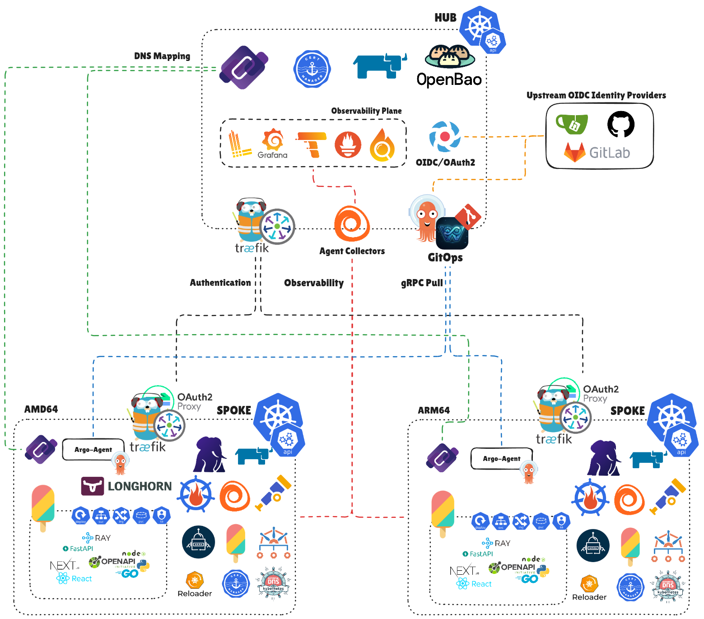
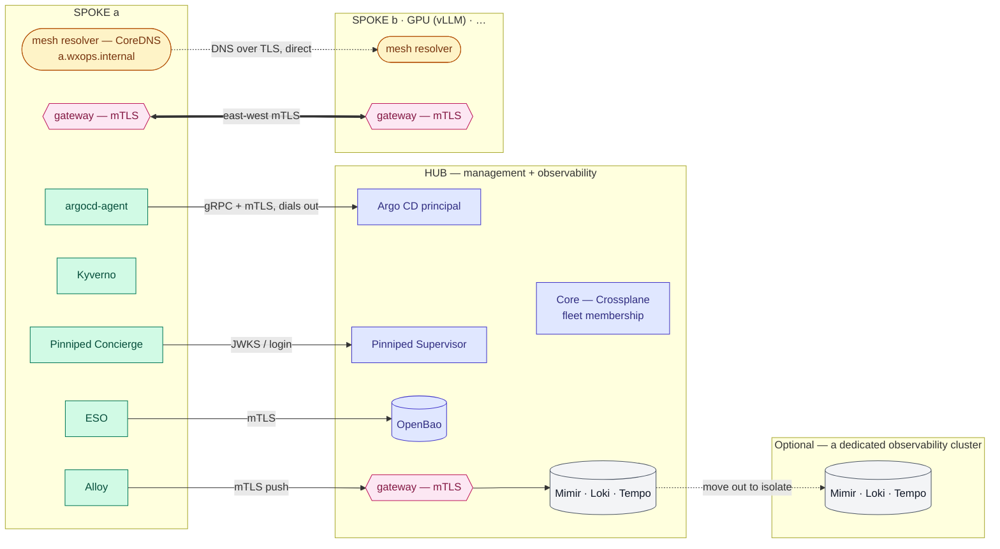
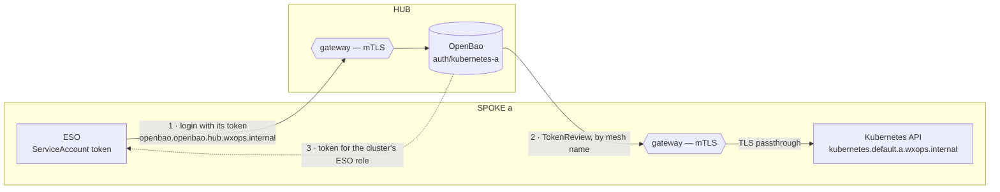

# Multi-Cluster — manage what you are given, connect it by name

> [!NOTE]
> **Status: direction, not implemented.** Replaces the CAPI-era family — [`multi-cluster.md`](../_archives/multi-cluster.md),
> [`multi-cluster-proposal.md`](../_archives/multi-cluster-proposal.md), [`multi-cluster-connectivity.md`](../_archives/multi-cluster-connectivity.md),
> [`multi-cluster-scale.md`](../_archives/multi-cluster-scale.md) — archived 2026-10-20. Written from a design discussion and the KubeCon EU 2020 talk
> [*CoreDNS for Hybrid and Multi-cloud*](https://static.sched.com/hosted_files/kccnceu20/6b/KubeCon%20-%20Amsterdam%20-%20CoreDNS.pdf); refine it here
> before an RFC is written. The idea grows from the author's earlier writing:
> [*The Story of Mine about Multi-Region Architecture*](https://wiki.xeusnguyen.xyz/Tech-Second-Brain/Personal/DevSecOps/The-Story-of-Mine-about-Multi-Region-Architecture) and
> [*To Cloud-Native Multi-Cluster with ExternalDNS*](https://wiki.xeusnguyen.xyz/Tech-Second-Brain/Personal/DevSecOps/To-Cloud-Native-Multi-Cluster-with-ExternalDNS).

---



## The idea

W'xOps **manages clusters it is given; it does not provision them**. A cluster — k3s, Talos, RKE2, kubeadm, EKS, AKS, GKE — joins a fleet by being
registered. Every management channel between the hub and a spoke is **opened by the spoke**, and the clusters reach each other's workloads through a
**name-based L7 backbone**: CoreDNS answers `<service>.<namespace>.<cluster>.wxops.internal`, a gateway in each cluster terminates mTLS and routes by name.
No pod IP ever crosses a cluster, so no CNI, no cloud and no overlay product is a dependency — and the hub is not on the path between two spokes, so a hub
outage does not stop them talking.

### What changed, and why

The archived design had **CAPI provision spokes** and the hub hold every spoke's credentials. That pulled W'xOps into node lifecycle and cloud credentials,
and made the hub a trust root whose compromise was a fleet compromise — most of the archived connectivity analysis existed to contain that. The main reason
to want CAPI was controlling a spoke's apiserver flags so it would trust the hub's identity; once every channel is spoke-initiated, the hub needs no
credential for a spoke's API at all, and the reason disappears.

The talk the backbone comes from is candid about the other half: CoreDNS multi-cluster discovery assumes **non-overlapping pod CIDRs, every IP routable from
every cluster, headless services only, no ClusterIP**. That flat network is what CNI meshes (Cilium ClusterMesh, Submariner, Kilo) provide, and what ties a
fleet to one CNI. This design keeps CoreDNS for **names** and drops the flat network: names resolve to a **gateway**, never to a pod.

---

## Principles

1. **Manage, don't provision.** Bring your own cluster. Creating, upgrading and repairing clusters is out of scope.
2. **The spoke dials out.** Delivery, telemetry, identity and secrets are spoke-initiated; the hub holds no spoke kubeconfig, and `:6443` is never exposed
   publicly. One call goes the other way: OpenBao checking a spoke's ServiceAccount tokens against that spoke's API, by name, over the mesh
   ([secrets across clusters](#secrets-across-clusters--eso-to-openbao-over-the-mesh)).
3. **The hub is a control-plane dependency, never a runtime one.** Spoke-to-spoke traffic does not transit it. Spokes only **watch** the hub and Git for
   fleet state — who is in the fleet, at which address — and keep the last-known copy; a hub outage freezes changes, it does not cut traffic.
4. **Route by name at L7, not by IP at L3.** Overlapping CIDRs, different CNIs and different clouds are all fine.
5. **One shape on every cluster, generated, never hand-written.** The same resolver, the same gateway, the same policies; the per-cluster differences are
   rendered from the fleet's membership list.
6. **Kubernetes only.** Every fleet member is a Kubernetes cluster. Other platforms — ECS, Nomad, VMs, managed services — are never managed or abstracted;
   they are reached as external services by name through a gateway: calling in with a client certificate from the fleet's CA, or called through a route
   that points at their address. Mixing platforms under one control plane trades each platform's strengths for a lowest common denominator — two identity
   models, two network models, one API that is neither.

---

## The shape



Three planes, each with its own rule:

| Plane | What travels | Mechanism | Direction |
|---|---|---|---|
| **Management** | desired state, policies, identity, secrets | Argo CD Agent (gRPC, mTLS); Pinniped Concierge; ESO | spoke → hub, outbound only |
| **Naming** | "where is `<svc>.<ns>.<cluster>`?" | a W'xOps CoreDNS **mesh resolver** per cluster; DNS-over-TLS between resolvers | resolver → the owning cluster's resolver, directly |
| **Data** | requests between workloads | one **gateway** per cluster: mTLS, routes by host name / SNI | caller's cluster → callee's gateway, directly |

---

## The management plane

| Need | Tool | Notes |
|---|---|---|
| Deliver to many clusters without the hub holding their credentials | [**Argo CD Agent**](https://argocd-agent.readthedocs.io/stable/features/) — principal on the hub, agent on each spoke | gRPC over mutual TLS. **Autonomous** mode (Applications defined on the spoke, status synced up) for prod; **managed** mode (defined on the hub, pushed down) for dev. Still in active development upstream |
| Human access to any cluster, managed ones included | **Pinniped** — Supervisor on the hub trusting Dex, Concierge on every cluster | **A bootstrap prerequisite, not synced by Argo** — see below; [access model](access-model.md#kubernetes-pinniped--rbac--kyverno) |
| Secrets on each spoke | **ESO** on the spoke, against OpenBao by name over the backbone, logging in through its cluster's own Kubernetes auth mount ([below](#secrets-across-clusters--eso-to-openbao-over-the-mesh)) | ESO keeps the last synced Secret if OpenBao is unreachable |
| Telemetry | **Alloy** on each spoke, pushing to the LGTM stack on the hub — or to a dedicated observability cluster, where one is split out | Write-ahead buffering covers a collector outage up to its size |
| The same rules everywhere | Kyverno policies rendered by Crossplane from XRs Argo delivers, parameterised by a per-cluster `wxops-cluster-info` ConfigMap (`env`, `cluster-name`, `role`); the Kyverno controller is a bootstrap prerequisite | One policy set; `role` is `hub`, `spoke`, `observability`, `gpu`, … |

> [!IMPORTANT]
> **Pinniped and the Kyverno controller are part of a cluster's bootstrap, not of GitOps.** Every person's access to every cluster runs through Pinniped, and
> every policy runs on Kyverno, so a sync that breaks either removes the very access or protection needed to repair it. Both are installed with the cluster,
> kept stable, and upgraded deliberately by hand — their manifests are versioned with the bootstrap, but Argo does not sync them. Nothing in W'xOps installs
> them. Everything above them in this table is delivered by Argo; W'xOps's policies are rendered by Crossplane
> for the Kyverno already there.
>
> - **Public certificates for the two login endpoints** — Dex and the Supervisor's issuer. Browsers, every kubeconfig and every cluster's
>   `JWTAuthenticator` verify them; with a public CA none of them needs a CA bundle. If they must be private, use one root CA and one distributed bundle,
>   never a self-signed certificate per service.
> - **The issuer URL never changes.** It is inside every token and every kubeconfig; changing it breaks every cluster's authenticator and every user's
>   kubeconfig at once.
> - **The Concierge's impersonation proxy is the access path on every cluster, self-managed included** (decided 2026-11-04): people never reach the API
>   server directly — every request enters through the proxy, which authenticates it and asks the API server to authorize it. The client-certificate
>   strategy is not used; on RKE2 it also reports `cluster-info not found`, which is expected. Check with `kubectl get credentialissuer -o yaml`:
>   `ImpersonationProxy` `Success`.
> - **The proxy is on every person's request path, so run it like one:** two or more Concierge replicas, a PodDisruptionBudget, anti-affinity where there
>   are nodes to spread over, and a Pinniped release built for the cluster's Kubernetes version (**Kubernetes v1.36 with Pinniped v0.46.0**, kept within one
>   minor version of each other; restart the Concierge after a cluster upgrade). Each request the proxy forwards makes a SubjectAccessReview, so **nothing
>   may sit on access reviews**: on the hub 2026-11-04 logins timed out because a Kyverno webhook was registered for every cluster-scoped CREATE, access
>   reviews included, and waited on a slow Kyverno — fixed in `platform-policy` (see [RFC-009](../rfc/009-scm-personas.md#as-built-2026-10-26)).
> - **The Supervisor is a hub dependency for new logins** — existing sessions run to expiry during a hub outage. Run it with more than one replica.
> - **Keep the bootstrap admin kubeconfig offline** as break-glass; Pinniped is the everyday path, not the only one.
>
> Steps: the [setup guide](../../docs/user-guide/setup.md).

---

## The naming plane — CoreDNS as the backbone

### Names

```text
<service>.<namespace>.<cluster>.wxops.internal          payment-api.payment.b.wxops.internal
```

`.internal` is reserved by ICANN for private use, so it can never collide with a public name. Each cluster is **authoritative for its own sub-zone**
(`b.wxops.internal`) and answers every name in it with **its own gateway's address**. Which services actually answer is the gateway's business, not DNS's —
DNS stays a trivial wildcard.

### A W'xOps resolver, not the distribution's DNS

The cluster DNS is configured differently on every distribution — the `coredns-custom` ConfigMap with `*.server`/`*.override` keys is a k3s and AKS
convention, EKS ships CoreDNS as an add-on with its own Corefile, RKE2 configures it through chart values, and **GKE runs kube-dns** by default. So W'xOps
runs **its own CoreDNS** — a small Deployment in `wxops-system`, the same image and Corefile shape on every cluster — and touches the distribution's DNS with
exactly **one stub-domain forward**:

| Distribution | The one line: `wxops.internal` → the mesh resolver's Service IP |
|---|---|
| k3s, AKS | a `wxops.server` key in the `coredns-custom` ConfigMap |
| EKS | a server block in the add-on's Corefile |
| RKE2 | the CoreDNS chart's values |
| GKE (kube-dns) | `stubDomains` in the `kube-dns` ConfigMap |
| kubeadm, Talos | a server block in the `coredns` ConfigMap |

The distribution's DNS keeps doing in-cluster resolution untouched; a mistake in mesh configuration cannot break `cluster.local`.

### The resolver's Corefile

A sketch for cluster `a` — not yet run:

```text
a.wxops.internal:53 {                       # own zone, for this cluster's pods
    template IN A a.wxops.internal {
        answer "{{ .Name }} 60 IN A 198.51.100.10"      # a's gateway
    }
}
tls://a.wxops.internal:853 {                # the same zone, served to peers over DoT
    tls /certs/tls.crt /certs/tls.key /certs/ca.crt {
        client_auth require_and_verify      # peers present a fleet certificate; answers reveal topology
    }
    template IN A a.wxops.internal {
        answer "{{ .Name }} 60 IN A 198.51.100.10"
    }
}
b.wxops.internal:53 {                       # one block per peer — straight to that peer, never via the hub
    forward . tls://203.0.113.20:853 {
        tls_servername dns.b.wxops.internal
        tls /certs/tls.crt /certs/tls.key /certs/ca.crt
    }
    cache 30
}
# gpu.wxops.internal, obs.wxops.internal, hub.wxops.internal … — same shape
reload
```

`reload` applies a changed Corefile without a restart; the change reaches the file only when the kubelet refreshes the mounted ConfigMap, typically within
a minute or two (and never through a `subPath` mount).

### The peer list is generated

With N clusters, every resolver lists N−1 peers. Written by hand, those N files drift. Instead each cluster's membership XR publishes its gateway and DNS
endpoint in status, and every resolver's peer blocks are **rendered from the membership list** — the same pattern as `XOIDCConnector` generating its team
list from labelled `XScmTeam`s. Joining a cluster is one XR; Argo carries the result to every other cluster; leaving reverses it.

The rendered peer list lives **on each spoke** — its resolver's config and its gateway's routes. Spokes pick up changes by watching the hub and Git;
while the hub is down they keep the last-known list, so spoke ↔ spoke resolution and traffic continue unchanged. Only joins, leaves and address changes wait
for the hub to return.

---

## The data plane — one gateway per cluster

- **Reachable from peers.** The gateway listens on 443 (and 853 for the resolver) at an address peers can reach — a public IP or a private interconnect;
  the design does not care which, but gateway addresses must not overlap. This is the one inbound path on a spoke; the management plane stays outbound-only,
  and `:6443` is never public — the spoke's API is exported on its gateway to the hub's OpenBao only, for token reviews.
- **mTLS both ways.** The gateway accepts only client certificates from the fleet's CA and routes by host name or SNI to a local Service.
- **Exporting a service is creating a route.** A service is reachable from other clusters only if a route for `<svc>.<ns>.<cluster>.wxops.internal` exists
  on its gateway — an explicit, reviewable object. Kyverno checks it against the [access model](access-model.md)'s owner label: only `payment` exports
  `payment-*`, and the route's allowed callers are owners the policy permits.
- **What crosses:** HTTP, gRPC and TLS-wrapped TCP. **What does not:** anything that needs the peer's pod IP — multicast, gossip protocols that advertise pod
  addresses, replication that dials pod IPs. Those stay inside one cluster, or get a protocol-specific route.
- **People reach a cluster's API through Pinniped, never through a raw `:6443`.** Where the Concierge runs its impersonation proxy, that proxy is the
  authenticated entry: exposed by a LoadBalancer, or through the gateway with **TLS passthrough** routed by SNI — it issues and checks its own client
  certificates, so nothing in front of it may terminate TLS. No person is given a route to the API server itself.

---

### Secrets across clusters — ESO to OpenBao over the mesh

JWT/OIDC login is for **people**. Workloads — ESO first — log in with **Kubernetes auth, one mount per cluster**, and the mesh carries both directions:



- **One Kubernetes auth mount per cluster** (`auth/kubernetes-<cluster>`), created when the cluster joins. Its `kubernetes_host` is the spoke's API **mesh
  name**, `kubernetes.default.<cluster>.wxops.internal`, resolved by the hub's mesh resolver; its CA is the spoke's API CA. Each mount has one role per
  consumer — ESO's first — bound to that ServiceAccount, with policies for that cluster's tenants only. A cluster's access is revoked by removing its mount.
- **The spoke's API is exported for token reviews only.** A route on the spoke's gateway passes TLS through to the API server for that one name, and accepts
  only the hub's fleet certificate. People still reach the API through Pinniped; nothing else on the hub calls it.
- **Both legs are mTLS** through the gateways, so OpenBao is never public and the spoke's API never is either.
- **Written on the hub** as `provider-vault` resources ([RFC-008](../rfc/008-built-in-tools-identity-and-catalog.md#openbao)), from the cluster's
  membership — see the join kit below.

---

## Problems the backbone solves

The point of the backbone is that clusters can **specialise** — one holds the GPUs, one holds the observability stack, one holds the hub — and every other
cluster reaches them by name:

| Need | Name a spoke calls | Served by | Why it matters |
|---|---|---|---|
| **Secrets** — ESO and workloads reading OpenBao | `openbao.openbao.hub.wxops.internal` | the hub's gateway | One OpenBao for the fleet without exposing it publicly or running one per cluster |
| **AI inference on GPUs** | `vllm.ai-suite.gpu-01.wxops.internal` | a GPU cluster | GPUs are expensive and few; one GPU cluster serves every spoke. A second GPU cluster is a second name, and moving a model is a DNS change |
| **Centralised monitoring** | `mimir.monitoring.hub.wxops.internal`, `loki…`, `tempo…` | the hub, by default | One LGTM stack for the fleet; Alloy on every spoke pushes to it over mTLS. It is the heaviest workload, so it can move to its own cluster to keep it off the hub — then only the name Alloy pushes to changes (`…obs.wxops.internal`) |
| **Identity** | `dex.dex.hub.wxops.internal`, Pinniped Supervisor | the hub | Login and token validation from every cluster |
| **Delivery** | the Argo CD principal | the hub | The agent's one outbound connection |
| **Shared data services** | `pg-shared.databases.data-01.wxops.internal` (TLS TCP route) | a data cluster | A shared CNPG pool used from several clusters |
| **North-south** — users to the nearest healthy cluster | public names | [k8gb](https://www.k8gb.io/) — per-cluster CoreDNS serving a delegated zone | Same toolbox, other direction; carried over from the [archived scale study](../_archives/multi-cluster-scale.md) |

---

## When something fails

| Down | Effect |
|---|---|
| **The hub** | Spoke ↔ spoke traffic and running workloads continue. Argo agents keep what is deployed; whether an autonomous agent keeps syncing from Git during the outage is a spike item. New human logins fail (Supervisor), existing sessions run to expiry. ESO keeps last-synced Secrets. New certificate issuance pauses |
| **A peer cluster** | Only names under that peer's zone fail; nothing else does |
| **A peer's resolver** | Its names stop resolving for others; cached answers last their TTL |
| **The LGTM stack** (on the hub, or its own cluster) | Alloy buffers and sends later; nothing else is affected |
| **A GPU cluster** | Inference calls fail; with two GPU clusters, a name change moves traffic |

The hub can be rebuilt without touching a spoke: the membership XRs, the policies and the generated configuration are all in Git.

---

## Where Core fits

### Membership, not provisioning

One XR per registered cluster — name to be decided — whose composition produces the **join kit**:

- the Argo agent's registration on the principal;
- the cluster's mesh certificates (resolver, gateway, Alloy client);
- its `wxops-cluster-info`;
- its sub-zone, published in status (gateway and DNS endpoint) for every other cluster's resolver to render;
- its OpenBao Kubernetes auth mount and ESO's role on it (`provider-vault`, on the hub), and the gateway route exporting its API for token reviews.

Removing the XR removes the cluster from the fleet. Declarative, and no hand-written controller. Pinniped is not in the join kit: a cluster arrives with it
already installed, as a [bootstrap prerequisite](#the-management-plane).

### Where compositions run

`spec.parameters.cluster` exists on `XTenantApp`, `XTenantDatabase` and `XPlatformDatabaseCluster` today, threaded to a `provider-kubernetes`
`ProviderConfig` — the hub applying resources **into** a spoke's API. That is exactly the hub → spoke credential this design removes. Two ways forward:

| | Crossplane on each spoke (recommended) | Hub `ProviderConfig` per spoke |
|---|---|---|
| How | Argo delivers the Core packages and the XRs to the spoke; the spoke's own Crossplane composes locally | The hub's provider applies into each spoke |
| Hub → spoke credential | **none** | one per spoke, plus an inbound `:6443` or a tunnel |
| Blast radius | one cluster | the fleet |
| Cost | N Crossplane installs to keep at the same version | none extra |

With Crossplane on each spoke, `cluster` keeps its default (`"default"`, the local cluster) everywhere. The field stays — a released XRD is additive-only —
but becomes the single-cluster case rather than the fleet mechanism. Hub-scoped kinds (SCM, OIDC, platform-tool configuration, membership) stay on the hub.

---

## Identity across clusters

- **People:** Pinniped, per the [access model](access-model.md). One login, groups `<org>:<team>`, per-cluster credentials.
- **Workloads calling across clusters:** the fleet CA's certificates at the gateway. The certificate identifies the calling cluster and, if issued per
  ServiceAccount, the calling workload — which is what an owner-based export rule needs.
- **The resolvers and Alloy:** fleet certificates too, so DoT and telemetry are authenticated, not just encrypted.
- **Secrets access:** ESO's ServiceAccount, through its cluster's own Kubernetes auth mount in OpenBao, with token reviews over the mesh
  ([above](#secrets-across-clusters--eso-to-openbao-over-the-mesh)).

### Managed clusters — GKE, EKS, AKS

The persona model carries over unchanged: `XPersonaBinding`'s `RoleBinding`s and Kyverno's admission policies are plain Kubernetes, the same on every
distribution. What differs is how a managed cluster comes to trust a W'xOps login, and that each cloud opens a second authorization path beside Kubernetes RBAC.
Checked against each vendor's documentation on 2026-10-27.

**Login.** Pinniped's Concierge works on EKS, GKE and AKS, through its **impersonation proxy**: the client-certificate strategy needs a pod beside the
`kube-controller-manager`, which most managed services do not allow, and the proxy by default needs a `LoadBalancer` Service. People log in through the SCM and
Dex only — no cloud console account. Kyverno still sees the person: impersonation sets the request's user and groups before authorization and admission run.
The same proxy W'xOps uses on its own clusters, so managed and self-managed clusters share one access path. EKS could also trust Dex directly (an associated
OIDC identity provider — the issuer reachable from the public internet, no self-signed certificates); W'xOps does not use that, since it puts people on the API
server itself.

**Group names must arrive unchanged.** EKS's OIDC association takes a `groupsPrefix` (`oidc:` turns `wxops-idp:payment` into `oidc:wxops-idp:payment`), and
AWS recommends one per provider. Every W'xOps rule matches `<org>:<team>` exactly — `scope: owned`, `owner-seal`, the Kyverno SCM-user match — so a prefix on one
cluster silently stops all of them there. Through Pinniped there is no prefix; through EKS's own OIDC, set none, or the same one fleet-wide and teach the
match about it.

**Cloud IAM is a second door.** Each cloud can authorize Kubernetes API calls from its own IAM, and a grant there is enough on its own:

| Cloud | The second path | How it combines with Kubernetes RBAC |
|---|---|---|
| GKE | IAM roles on the project or cluster (`container.*`) | RBAC is checked first; with no RBAC grant, GKE checks IAM — either one authorizes |
| EKS | Access entries with access policies (`AmazonEKSClusterAdminPolicy`, …) | The principal holds every associated policy's permissions plus whatever RBAC grants its groups. `kubectl auth can-i --list` does not show access-policy permissions |
| AKS | Microsoft Entra ID authorization (Azure RBAC for Kubernetes) — on by default in AKS Automatic | An authorization webhook asks Entra ID; both models can run on one cluster. Role assignments at a resource group or subscription reach every cluster under it |

So: **cloud IAM grants in-cluster access to the platform team and break-glass only** — the managed-cloud equivalent of `system:masters`. A developer given
*Azure Kubernetes Service RBAC Writer* or an EKS access policy bypasses the persona model, and nothing in W'xOps sees it; `kubectl auth can-i` does not either, on EKS. Review those
grants in the cloud's own audit trail, alongside the fleet's.

**Workload identity is a different question.** IRSA and EKS Pod Identity, GKE Workload Identity and AKS Workload Identity let a pod call cloud APIs. Personas
govern people and agents calling the Kubernetes API, so the two do not overlap; workload identity matters only where a W'xOps component calls a cloud service
itself, such as ESO against a cloud secret manager instead of OpenBao.

---

## What W'xOps does not do

- Provision, upgrade or repair clusters — CAPI and its trust root are dropped.
- Hold a kubeconfig for any spoke, or expose any spoke's `:6443` publicly — the API is on the mesh for OpenBao's token reviews only.
- Require a CNI, a flat pod network, non-overlapping CIDRs, or an overlay product.
- Route spoke-to-spoke traffic through the hub.
- Run a virtual control plane over non-Kubernetes platforms (ECS, Nomad, VMs). Where a team wants another platform's capacity *behind* the Kubernetes API, [Virtual Kubelet](https://virtual-kubelet.io/docs/providers/) is the upstream way — it presents that platform as a node, so the cluster stays Kubernetes. It is not part of W'xOps's fleet model, which stays on CoreDNS names and gateways.
- Edit a distribution's DNS beyond one stub-domain forward.

---

## Known limits

- **One inbound path per spoke** — the gateway. "Zero inbound ports" holds for the management plane only; a spoke that serves others must be reachable.
- **L7 and TLS-wrapped TCP only.** Protocols that need peer pod IPs stay in one cluster.
- **Failover is as fast as DNS caching allows** — keep TTLs short on mesh names.
- **The distribution hook differs** per distribution — one line, but one line per distribution to know.
- **Certificate issuance depends on the hub**; certificate lifetimes are how long a spoke tolerates a hub outage.
- **Argo CD Agent is young** upstream; its outage behaviour is unverified here.

---

## Decisions taken

1. W'xOps manages clusters it is given; provisioning is out of scope.
2. Management plane outbound-only; one inbound mTLS gateway per spoke for the data plane; `:6443` never public — exported on the mesh to the hub's OpenBao
   for token reviews only.
3. Names: `<svc>.<ns>.<cluster>.wxops.internal`; each cluster authoritative for its own zone; peers forward directly over DoT with client certificates.
4. A dedicated W'xOps mesh resolver, hooked into the distribution's DNS by one stub-domain forward.
5. Peer configuration generated from fleet membership, never hand-written.
6. Exporting a service is a gateway route, checked by policy against the owner label.

## Open decisions

1. **The fleet CA** — OpenBao PKI, or cert-manager with a shared CA; per cluster or per ServiceAccount certificates. Per ServiceAccount points at
   [SPIFFE/SPIRE](https://spiffe.io/) (CNCF graduated): one identity format for workloads, agents and the gateway's export rules, issued per workload.
2. **The gateway** — Traefik, already in the stack (`XTenantApp` routes through it) and able to require client certificates; or Envoy Gateway, for
   authorisation per calling identity.
3. **Location-transparent names later?** CoreDNS ≥ 1.12.2 serves the Multi-Cluster Services `clusterset.local` names from its `kubernetes` plugin, but
   something must create the `ServiceImport`s. Start with explicit per-cluster names.
4. **Crossplane per spoke** — confirm, and decide how its version is kept in step with the hub's.
5. **The membership kind** — name, group (`platform`), and exactly what the join kit contains.
6. **Underlay per environment** — public addresses with source allow-lists, or a private interconnect. The design works over either.
7. **The cluster's identity object** — the per-cluster `env`, `cluster-name`, `role` that compositions read. [RFC-009](../rfc/009-scm-personas.md#open-questions)
   (personas) is waiting on it for its environment gate: an `XPersonaBinding` renders only on clusters whose environment its persona reaches. Today's sketch is
   the `wxops-cluster-info` ConfigMap; a Crossplane `EnvironmentConfig` is the alternative, cluster-scoped and read directly by `function-extra-resources`.
8. **The token reviewer** — a reviewer ServiceAccount token stored in each Kubernetes auth mount (bound to `system:auth-delegator` on the spoke), or ESO's own
   token used as the reviewer, so OpenBao holds no spoke credential at all (to verify against OpenBao). `provider-vault`'s Kubernetes `AuthBackendConfig` takes either
   (`tokenReviewerJwtSecretRef`, or `disableLocalCaJwt`) — see [`providers/config/examples/openbao/03-kubernetes-auth-per-cluster.yaml`](../../providers/config/examples/openbao/03-kubernetes-auth-per-cluster.yaml).
9. **The egress path.** Most workloads speak plain HTTP and will not present a client certificate themselves, so a call to another cluster needs a local hop
   that originates the mTLS: pod → its own cluster's gateway (plain, in-cluster) → the callee's gateway (mTLS) — spoke to spoke, never through the hub. Open:
   - **which component originates it** — the same gateway in an egress role, or a separate egress proxy;
   - **how a pod reaches it without code changes** — the mesh resolver answering `*.wxops.internal` with the local egress address, or an explicit proxy
     setting;
   - **what identity the callee sees** — the calling cluster (one certificate per gateway), or the calling workload (certificates per ServiceAccount at the
     egress, which owner-based export rules need).

## Carried over from the archived family

Still valid and not repeated here — read them in the archive: the multi-region data strategy (region-pinned by default, CNPG replicas for DR), tenancy
isolation tiers, edge and ARM sites (k3s/Talos per autonomous site), GPU pools and the missing `scheduling:` block, and the k8gb GSLB comparison — all in
[`multi-cluster-scale.md`](../_archives/multi-cluster-scale.md).

## Sources

- Background — the author's earlier articles: [*The Story of Mine about Multi-Region Architecture*](https://wiki.xeusnguyen.xyz/Tech-Second-Brain/Personal/DevSecOps/The-Story-of-Mine-about-Multi-Region-Architecture) · [*To Cloud-Native Multi-Cluster with ExternalDNS*](https://wiki.xeusnguyen.xyz/Tech-Second-Brain/Personal/DevSecOps/To-Cloud-Native-Multi-Cluster-with-ExternalDNS)

- [CoreDNS for Hybrid and Multi-cloud — KubeCon EU 2020 slides](https://static.sched.com/hosted_files/kccnceu20/6b/KubeCon%20-%20Amsterdam%20-%20CoreDNS.pdf)
- [Argo CD Agent — features](https://argocd-agent.readthedocs.io/stable/features/) ·
  [agent configuration](https://argocd-agent.readthedocs.io/stable/configuration/reference/agent/)
- [CoreDNS `multicluster` plugin](https://coredns.io/explugins/multicluster/) · [coredns/multicluster](https://github.com/coredns/multicluster)
- [k8gb](https://www.k8gb.io/)
- Managed clusters: [Pinniped — supported clusters](https://pinniped.dev/docs/reference/supported-clusters/) ·
  [EKS — external OIDC provider](https://docs.aws.amazon.com/eks/latest/userguide/authenticate-oidc-identity-provider.html) ·
  [EKS — access policies](https://docs.aws.amazon.com/eks/latest/userguide/access-policies.html) ·
  [GKE — RBAC and IAM](https://docs.cloud.google.com/kubernetes-engine/docs/how-to/role-based-access-control) ·
  [AKS — cluster authorization](https://learn.microsoft.com/en-us/azure/aks/concepts-cluster-authorization)
