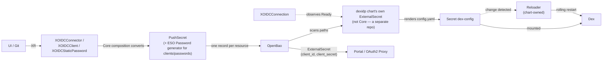

# RFC-004: Dex as the identity provider — Core-rendered configuration, OpenBao-held secrets, Portal authentication

## Status
<!-- Draft | In review | Accepted | Declined | Withdrawn | Implemented — and the GitHub issue that carries the discussion, e.g. "Draft · #42" -->
Implemented (Phases 0–2.5)

> [!NOTE]
> **Amended, implemented.** The design below is unchanged in its core argument — configuration, not an operator or Dex's API; OpenBao as
> the record; rotation driven by a refresh/generation, not scheduled; the claim contract and rollout-safety layers. Two things changed once real
> building started:
>
> 1. **The aggregator moved out of this repo.** It is no longer hand-written platform GitOps — it ships as the W'xOps
>    [`dexidp` Helm chart](https://github.com/wxops-idp/charts/tree/main/dexidp), a reusable wrapper around the upstream Dex chart. Core's compositions
>    write records to OpenBao and nothing else; they render no config, install no broker, and restart nothing. `XOIDCConnection` observes the chart's
>    own config `ExternalSecret` for its Ready condition — Core's only window into "did the broker get every record".
> 2. **The kinds are renamed and regrouped**, to read as a protocol (ADR-002 already reserves `auth.wxops.cloud` for identity configuration, and
>    rejects naming a group after a technology): `XDexConnector` → **`XOIDCConnector`**, and a new **`XOIDCConnection`** (which broker, where its
>    records live) and **`XOIDCStaticPassword`** (a local user — the bootstrap admin, break-glass) that this RFC's first draft did not have.
>    `XOIDCClient` keeps its name. `scm-team` (RFC-003 Phase 2) ships alongside these and is what makes `XOIDCConnector`'s team allow-list
>    *generated* rather than hand-maintained — see §The flow, below.
>
> Implemented: `oidc-connection`, `oidc-static-password`, `oidc-client`, `oidc-connector` (`package/auth/`). Records, remote-key layout and the
> gRPC-API alternative were all re-examined against Dex v2.46.0's actual source before building — see §Records in OpenBao and §Alternatives.

## Summary

Adopt [Dex](https://dexidp.io) as the platform's OpenID Connect issuer and manage its **configuration entirely through Core-written OpenBao records**, with
no operator and no call to Dex's API. Four kinds: **`XOIDCConnection`** (which broker, where its records live), **`XOIDCConnector`** (an upstream Git
vendor), **`XOIDCClient`** (an application that logs in through the broker) and **`XOIDCStaticPassword`** (a local user — the bootstrap admin,
break-glass), each converting their parameters into one record in OpenBao. The W'xOps [`dexidp` Helm chart](https://github.com/wxops-idp/charts/tree/main/dexidp)
— not this repo — gathers every record with its own `ExternalSecret`, renders Dex's `config.yaml` into a Secret, Dex mounts it, and Reloader restarts Dex
when it changes; `XOIDCConnection` only observes that chart-owned `ExternalSecret`'s Ready condition. `XOIDCConnector`'s per-org team allow-list is
**generated** from [`XScmTeam`](003-scm-connections-and-resources.md)s labelled for login, not hand-maintained. The Portal authenticates its users through
Dex as the first client; OAuth2 Proxy is the second consumer of the same contract. Dex itself stays platform infrastructure installed through GitOps (the
chart). The claims Dex issues are the input to the authorization model in [RFC-005](005-git-mapped-authorization.md).

## Motivation

The Portal is a separate repository that will sit in front of every Core API ([`portal-integration.md`](../../docs/user-guide/portal-integration.md)), and
nothing today answers who a user is. Three gaps:

1. **No single login.** People already have identities at their Git vendor. Without an issuer between the vendor and each application,
   every application integrates with each vendor separately or is left unauthenticated.
2. **Dex configuration would be hand-maintained.** Connectors and clients are entries in one file. Edited by hand, they have the problems
   [RFC-003](003-scm-connections-and-resources.md) describes for vendor-side apps: no record of what exists, who owns it, or when its
   secret last changed, and a mistake in one entry affects every login.
3. **Authorization has no input.** The next RFC maps authorization to Git state — who is in which org or team. That is only possible if a
   person's Git memberships arrive as claims in a token the platform can verify.

## Detailed Design

### Scope

| In this RFC | Not in this RFC |
|---|---|
| `XOIDCConnection`, `XOIDCConnector`, `XOIDCClient`, `XOIDCStaticPassword` and the OpenBao record each writes | Installing and operating Dex itself — the W'xOps `dexidp` chart, platform GitOps |
| `XOIDCConnection` observing the chart's own aggregating `ExternalSecret`, and Reloader (both chart-owned) | The authorization model — Kyverno, ABAC, RBAC mapping (RFC-005) |
| The claim contract Portal and OAuth2 Proxy rely on | Deploying OAuth2 Proxy or the Portal |
| Rotation of client secrets | **Tenant-created** clients — not supported by design: the platform team defines every client |
| `XOIDCConnector`'s team allow-list generated from `XScmTeam` | `scm-team` itself (RFC-003 Phase 2) |

The `XOIDC*` kinds are named for the protocol, and Dex is the vendor implemented first. A different broker would need its own records and chart, not a change to
these kinds; this RFC deliberately does not generalise past Dex before a second one exists.

### Why configuration, not an operator or Dex's API

Dex reads its connectors and its static clients from one config file. **Re-checked against Dex v2.46.0's actual source** (not assumed, as this RFC's
first draft had to): the gRPC API now covers all three object types CRUD (clients, passwords, and — since
[dexidp/dex#1472](https://github.com/dexidp/dex/issues/1472) landed — connectors), gated behind `DEX_API_CONNECTORS_CRUD` (default off). That closes the
original objection that the API "cannot manage connectors at all." It does not change the decision: no IaC tool covers all three object types today
(`marcofranssen/dexidp`'s Terraform provider has `client` only; `loafoe/provider-dex`'s Crossplane provider has no password resource and replaces Dex's
own API module with a fork) — building that tooling is its own project, not a side effect of this one. Managing the **config file** uses the one interface
Dex documents as its configuration contract, works with any Dex storage backend, treats connectors and clients identically, and needs no new
provider or controller. The price is that a change restarts Dex. That price is accepted (see Drawbacks) and bounded (see Rollout safety). See
Alternatives for the full comparison, kept for the record.

### The flow



The UI never talks to OpenBao or ESO. It writes an XR — through Git or the API, per [open decision 3](../_archives/ROADMAP.md#open-decisions) — and Core does
the conversion. A commit carries a declaration, never a secret value, and `status` carries only the OpenBao path. `XOIDCConnection` is the one kind that reads
back from the chart's side: it observes the chart's aggregating `ExternalSecret`'s Ready condition, so a malformed record surfaces on the connection's own
status rather than only in the chart's logs.

### Records in OpenBao

One record per resource, under the platform store (mount `platform`), and `remoteKey` omits the KV mount prefix per the [Vault path
convention](../../CLAUDE.md#vault-path-convention). The prefix is `<vendor>` (the broker — `dex` is the only one today, named on `XOIDCConnection`), matching
the `dexidp` chart's own `dynamicConfig.sources` defaults exactly, so no chart value needs changing:

| Resource | `remoteKey` | Full logical path |
|---|---|---|
| Connector | `dex/connectors/{connectorId}` | `platform/dex/connectors/{connectorId}` |
| Client | `dex/clients/{clientId}` | `platform/dex/clients/{clientId}` |
| Client (the secret — written by the operator in `static`, by Core in `generate`) | `dex/clients-def/{clientId}` | `platform/dex/clients-def/{clientId}` |
| Static password (the record Dex reads) | `dex/users/{username}` | `platform/dex/users/{username}` |
| Static password (the password — written by the operator in `static`, by Core in `generate`, with `generation`) | `dex/users-def/{username}` | `platform/dex/users-def/{username}` |

A **client record** holds `id`, `name`, `redirectURIs` (JSON array), and one of `secret` / `secretEnv` / `public`. A **connector record** holds `type`, `id`,
`name`, and `config` — a JSON object carrying the vendor OAuth application's `clientID`/`clientSecret` alongside the connector's non-secret settings
(`orgs`, `redirectURI`, `teamNameField`, …; the exact shape differs per vendor, see `XOIDCConnector`'s own page). A **static-password record** holds `email`,
`username`, `name`, `userID`, `groups`, and a bcrypt `hash` — never the plaintext, which lives only at the `users-def` path for a human to read once. The
same connector/client record serves two readers: the chart's aggregator reads every field, and a consuming application's own `ExternalSecret` reads just
`client_id`/`client_secret` (or the client record's `secret`).

External Secrets Operator documents OpenBao as supported through its Vault provider (tested upstream with ESO v0.16.1 and OpenBao v2.2.0), so the store
definition changes and nothing else does. All records are in the platform store by design, because the platform team defines every client — see *Tenant clients*.

### API surface

```yaml
apiVersion: auth.wxops.cloud/v1alpha1
kind: XOIDCConnection
metadata:
  name: dex
spec:
  parameters:
    vendor: dex                              # enum [dex]; also the remote-key prefix every oidc-* kind writes under
    issuer: https://idp.wxops.local          # must equal the dexidp chart's own dynamicConfig.base.issuer
    secretStoreRef: {name: vault-platform}
    config: {namespace: dex, externalSecretName: dex-config}   # identifies the chart's own ExternalSecret, observed for status
status:
  created: true
  ready: true            # the chart's config ExternalSecret reports Ready: "True" — never that Dex has reloaded
  callbackUrl: https://idp.wxops.local/callback
```

```yaml
apiVersion: auth.wxops.cloud/v1alpha1
kind: XOIDCConnector
metadata:
  name: github
spec:
  parameters:
    connectionRef: {name: dex}
    connectorId: github
    scmRef: {name: github-wxops}        # the vendor ("gitea"/"github") becomes the broker connector `type`; baseUrl becomes hostName/baseURL
    oauthAppRef: {name: dex-github}     # client id/secret read from this XScmOAuthApp's OpenBao record
    orgs:                                # per org, every ready XScmTeam labelled scm.wxops.cloud/oidc-login: "true" in this org
      - name: wxops                      # contributes its team automatically — unioned with any listed here by hand
        teams: []
status:
  created: true
  ready: true
  vaultKey: platform/dex/connectors/github
  teams: {wxops: [platform-team, rocket-team]}   # the fully resolved per-org team list — what will appear in `groups`
```

```yaml
apiVersion: auth.wxops.cloud/v1alpha1
kind: XOIDCClient
metadata:
  name: portal
spec:
  parameters:
    connectionRef: {name: dex}
    clientId: wxops-portal
    displayName: W'xOps Portal
    redirectUris: [https://portal.example.com/auth/callback]
    public: false                # true = no secret, PKCE only, for browser-only apps
    owner: platform              # platform-defined; tenants do not create clients — see Tenant clients
    secret: {source: generate}   # or {source: static} reading <vendor>/clients-def/<clientId> — no OpenTofu, no external provider; ESO's own Password generator
    rotation:
      generation: 1              # bump to rotate now
status:
  created: true
  ready: true
  clientId: wxops-portal         # the secret never appears in status
  vaultKey: platform/dex/clients/wxops-portal
```

Both expose `status.created` and `status.ready` per the [status contract](../../docs/api-reference/status-contract.md). **What `ready` means here is narrower
than it sounds:** the record is written to OpenBao. Whether Dex has *loaded* it is a property of the chart's aggregator and Dex, not of the XR, and Core
cannot observe it directly — `XOIDCConnection.status.ready` is the closest proxy, since it reflects the aggregator's own render succeeding.

The vendor OAuth application behind a connector is an [`XScmOAuthApp`](003-scm-connections-and-resources.md), read through `oauthAppRef` — its
`status.vaultKey` is read, not assumed, so an app pushed to a non-conventional key is still found, and its `status.clientId` is read directly (it is not
secret) rather than round-tripped through OpenBao a second time. `scmRef` supplies the vendor and base URL from the matching `XScmConnection`. Dex does
not require SCM to exist — a connector could in principle be built without these references — but this RFC only builds the referenced form, since every
upstream connector this platform needs already has an `XScmConnection` and an `XScmOAuthApp`.

### Compositions

`XOIDCConnection` is a thin `function-patch-and-transform` pipeline — one `provider-kubernetes` `Object` with `managementPolicies: ["Observe"]` on the
chart's own config `ExternalSecret`; it writes nothing. The three record kinds are each `function-extra-resources` + `function-kcl` (the
`tenant-database` pattern), reading `XOIDCConnection` by the `crossplane.io/composite` label Crossplane stamps on every root XR with its own name — no
user-written discovery label needed:

- **`XOIDCClient` / `XOIDCStaticPassword`** — the shared "generate or static" pattern, as **two `ExternalSecret`s**, because ESO refreshes one
  `ExternalSecret` atomically (every `data`/`dataFrom` entry, the whole template), and a generator or `bcrypt`'s random salt redraws on every refresh:
  - **ESO1, `generate` only, owns the secret.** The `Password` generator → `{password|secret, generation}` → its own `PushSecret` →
    `<vendor>/{users,clients}-def/<id>` (the same path `static` mode's operator writes by hand). `refreshPolicy: Periodic` with a `99999h`
    interval: only a change to its top-level `force-sync` annotation, which carries `rotation.generation`, refreshes it — so only a deliberate bump
    ever re-runs the generator.
  - **ESO2, both modes, owns the record.** It reads the secret from `<kind>-def` through a plain `data[].remoteRef` (the same path whichever of a
    generator or the operator put it there — the secret never appears in this resource's `spec`), builds the whole record in one render — for
    `XOIDCStaticPassword`, including `{{ .password | bcrypt }}` (ESO v2's template engine merges in Sprig) — and pushes it. `refreshPolicy:
    OnChange`, so any field edit syncs on its own without touching the generator. In `generate` mode its render fails until `<kind>-def` carries
    `rotation.generation`, so a bump never settles on the previous secret.
  - The one accepted cost: `bcrypt` re-salts on every ESO2 render, so an unrelated edit changes the record's `hash` string (the password is
    unchanged) and `dex-config` changes once. The generated/read secret never exists in Git or in an XR field. `public: true` skips all of it — the
    record carries `"public": true`, built from literal XR fields with no remote data source at all.
- **`XOIDCConnector`** — reads the `XScmConnection` (vendor, base URL) and the `XScmOAuthApp` (`status.clientId`, `status.vaultKey`) by the same
  composite-label lookup, plus every `XScmTeam` labelled `scm.wxops.cloud/oidc-login: "true"` (a label-value selector, no per-XR name). It builds each
  org's team list by unioning the hand-listed `teams` with every matching team's `status.dexTeam`, then an `ExternalSecret` reads the oauth app's
  `client_secret` from OpenBao and templates the connector record.

None of this adds a Crossplane provider or any RBAC: `provider-kubernetes` already holds the grant for `externalsecrets`, `pushsecrets` and
`generators.external-secrets.io/passwords` in `providers/rbac-provider-kubernetes.yaml`, and the compositions still emit no RBAC. No OpenTofu, no
external Terraform provider, anywhere in this family.

### The aggregator — owned by the `dexidp` chart, not this repo

The aggregating `ExternalSecret` is **not a Core resource and not hand-written platform GitOps**, as this RFC's first draft proposed — it ships as part
of the W'xOps [`dexidp` Helm chart](https://github.com/wxops-idp/charts/tree/main/dexidp), a reusable wrapper around the upstream Dex chart, in its own
repository. Its real, working shape (confirmed against the chart's source, not illustrative):

```yaml
# dexidp chart — templates/externalsecret-config.yaml, abbreviated
spec:
  refreshInterval: 1m
  target:
    name: dex-config
    template:
      engineVersion: v2
      data:
        config.yaml: |
          {{- $cfg := fromJson `__BASE_JSON__` -}}   # dynamicConfig.base — issuer, storage, web, expiry; a chart value, in Git
          # ... merges $cfg.connectors/staticClients/staticPasswords with every record found below ...
  dataFrom:
    - find: {path: dex/connectors/, name: {regexp: ".*"}}
      rewrite: [{regexp: {source: "^(.*)$", target: "connector_$1"}}]
    - find: {path: dex/clients/,    name: {regexp: ".*"}}
      rewrite: [{regexp: {source: "^(.*)$", target: "client_$1"}}]
    - find: {path: dex/users/,      name: {regexp: ".*"}}
      rewrite: [{regexp: {source: "^(.*)$", target: "user_$1"}}]
```

Dex's fixed settings — issuer, storage, web listener, token expiry — are the chart's own `dynamicConfig.base` value, reviewed in Git like everything
else, but in the chart's repository, not this one. The template **fails closed**: a malformed record (missing field, duplicate id, a plaintext
password where a bcrypt hash is required) fails the whole render, and ESO leaves the previous `dex-config` Secret in place rather than writing a half-good
one. `XOIDCConnection.status.message` surfaces that failure's condition message. Each change to a record changes the rendered Secret at the next
`refreshInterval`, so Dex restarts at most once per interval however many records changed.

### Reloader

Stakater's [Reloader](https://github.com/stakater/Reloader), an open-source controller, restarts a workload when a Secret or ConfigMap it uses changes.
The `dexidp` chart sets its annotation on Dex's own Deployment by default (`podAnnotations: {reloader.stakater.com/auto: "true"}`) — this is chart
configuration, not something Core installs or manages. Consumers (Portal, OAuth2 Proxy) carry the same annotation for the Secret their own
`ExternalSecret` produces, in their own charts/manifests.

### Secrets and rotation in OpenBao

**OpenBao does not rotate a KV secret by itself.** It is the store of record: versioned KV v2 (every rotation is a new version, so the history answers *when did
this change*), per-path ACLs, and an audit log. Rotation is *driven* by ESO — the Password generator produces a new value once per `generation`, not on a
schedule the way this RFC's first draft proposed. The bump is stamped as the generator `ExternalSecret`'s own top-level `force-sync` annotation:
ESO compares `GetResourceVersion() = "<generation>-<hash(annotations, labels)>"` against what it last synced, so changing that annotation refreshes a
`Periodic` / `99999h` resource at once, while any other reconcile renders the same value and refreshes nothing. Both the bump and the resulting record
are visible in Git/Crossplane as a spec change, not a timer.

A rotation flows: new record in OpenBao → the chart's aggregator renders a new config → Reloader restarts Dex; in parallel the consumer's `ExternalSecret`
refreshes and Reloader restarts the consumer. A Dex client has exactly one secret, so between those two changes landing, logins for that client can fail.
Rotation is meant for quiet hours; a real overlap would need dual-secret support Dex does not offer.

The split is what answers this RFC's original open question about generator re-rotation: a generator is only re-evaluated when *its own*
`ExternalSecret` re-syncs, and nothing but a `generation` bump changes that resource — a controller restart or an edit to any other field does not
rotate a secret nobody asked to rotate. (A single `ExternalSecret` cannot give this: any refresh re-runs every source in it.)

**What was verified against ESO v1.2.1, and what it overturned** — the first implementation put `refreshInterval: "0"` on one `ExternalSecret` and
stamped `rotation.generation` into `spec.target.template.metadata.annotations`. That never re-synced, and the cause is in
`shouldRefreshPeriodic()`: with `refreshInterval <= 0` and one prior sync it returns `false` *before* it compares versions, so no change of any kind
can refresh it. Established in order, live and in source: `force-sync=$(date +%s)` has no handler in the controller (the constant exists only for
`ClusterExternalSecret` mirroring) and did nothing; `refreshPolicy: OnChange` fixed field edits but, as one atomic refresh, also re-ran the
generator on an unrelated `groups` edit; a `PushSecret` watches only its own CR, never its source `Secret`, so `refreshInterval` is its only timing
lever; and a property-empty `PushSecret` write *replaces* the whole remote document, while property-set writes one key as a raw string.

### Rollout safety

The design's failure mode is one entry breaking everyone's login, so it is defended in layers:

1. **Core validates before it writes.** The XRD schema and the composition reject malformed entries, so an invalid record never reaches
   OpenBao. Kyverno ([RFC-005](005-git-mapped-authorization.md)) adds ownership rules at admission.
2. **A rendering error leaves the last good config.** If the aggregator's template fails on a malformed record, ESO does not overwrite
   the existing Secret, so Dex keeps running the previous configuration.
3. **A semantically bad config stalls instead of taking Dex down.** A duplicate client id or an invalid connector would crash a new Dex pod;
   with at least two replicas and `maxUnavailable: 0` (the `dexidp` chart's Deployment, not Core's), the failing pod never becomes ready and the old pods keep serving. The change is
   stuck rather than an outage, and a stuck rollout is visible.
4. **Dex needs persistent storage.** In-memory storage would lose in-flight logins on every restart; `kubernetes` or SQL storage does not.

### Identity for the Portal

The Portal logs users in with the authorization-code flow against Dex, using the `portal` client. The contract the Portal and the authorization layer rely on is
the claims in the ID token:

| Claim | Source | Note |
|---|---|---|
| `sub`, `email`, `name` | The Git vendor, via the connector | `sub` is Dex's connector-scoped id, stable for a person per connector |
| `groups` | The vendor's orgs and teams | The input to RFC-005. The connector's team-name setting decides whether groups carry a team's display name or its slug; the slug is what RFC-005's owner rule expects, and the exact option is confirmed in the spike |
| `federated_claims.connector_id` | Dex | Which vendor the person authenticated through |

Two properties matter to RFC-005 and are stated now:

- **Claims are a snapshot taken at login.** A person removed from a team keeps the old `groups` until the token expires or is refreshed, so
  "1-to-1 with Git" has a lag equal to the token and refresh lifetimes. Those are a security setting, not a default to accept.
- **A group name is only unique within a vendor.** The same team name can exist on GitHub and GitLab, so the claim format should carry the
  connector; the normalised form is an open question.

### Tenant clients

**Clients are platform-defined.** The platform team chooses every client id and redirect URI, and tenants have no permission on `XOIDCClient` or any other `XOIDC*`
kind — they work only with the resources the platform provides. A platform feature that needs a login, such as an OAuth2 Proxy in front of an application, is one
the platform wires up by creating the client behind it. That removes the store-scope problem rather than solving it: every record lives in the platform store, the
chart's aggregator reads one prefix, and no tenant `ExternalSecret` has to reach a store it should not.

A tenant-facing way to ask for a client — for example through an SCM actions template — could be considered later, once that kind of feature exists. It is not
planned here, and nothing in the kinds blocks it.

### Compatibility and change tier

Four new packages — `oidc-connection`, `oidc-connector`, `oidc-client`, `oidc-static-password` — group `auth`, each `current: unreleased` in
`VERSIONS.yaml`; adding a package is `safe`. Each has its own `docs/api-reference/` page, an example, a `package/auth/<name>/README.md`, and test cases.
Nothing is applied with `make providers`: the broker and its Reloader annotation are the `dexidp` chart's job, installed in its own repository, not
`providers/`. Reference-stack additions here are the chart itself and the providers it depends on (ESO, Reloader) — see `CLAUDE.md`'s reference stack —
not Dex or Reloader as Core dependencies, since Core never installs either.

### Testing

- goldens: each connector vendor (gitea/github) and field-name difference (`baseURL` vs `hostName`); confidential vs `public` client; `generate` vs
  `static` for both `XOIDCClient` and `XOIDCStaticPassword`; the rendered record contents, including the bcrypt hash placeholder
- `observed.yaml` readiness cases via `mkobserved.py`
- negative cases: `public: true` with a `secret` set, empty `redirectUris`, an empty `orgs` list, `secret.source` unknown, `owner` other than `platform`
- invariants: `remoteKey` carries no KV mount prefix; no secret value in any XR field or status; the compositions emit no RBAC; no OpenTofu/external
  provider in any `auth` package

Offline tests prove the records Core writes. They do **not** prove that the chart's aggregator template renders a valid Dex config, or that Dex accepts
it — reimplementing the template in a test would prove the reimplementation, not ESO. That needs a cluster with ESO, OpenBao, the `dexidp` chart and Dex,
which is the kind-based e2e tier and, for the next release, a manual acceptance run.

## Drawbacks

- **Every change restarts Dex.** Adding a client or rotating a secret is a rolling restart, and the restart is bounded to one per refresh
  interval rather than avoided. A busier tenant-client future makes this cost recur.
- **One config, shared blast radius.** A bad entry can affect all logins; the defences above make that a stall rather than an outage, and
  they are defences, not guarantees.
- **The aggregator is hand-owned platform config** outside Core's reconcile loop. Its template is the most delicate file in this design.
- **The client secret exists in three places**: OpenBao, the rendered `dex-config` Secret, and the consumer's Secret. All are Secrets under
  the same RBAC review; none is a plain-text field in an object type made to be read.
- **`ready` does not mean live.** Core cannot see whether Dex has loaded an entry.
- **Rotation is not seamless**, and depends on ESO generator behaviour that needs verifying.
- **Dex is one more component on the login path.** If it is down, no one signs in to the Portal.
- **Reloader is a new dependency**, small and open-source, but a restart controller with access to Deployments.

## Alternatives

- **Write Dex's `OAuth2Client` custom resources** through `provider-kubernetes` (this RFC's earlier design). Clients then need no restart,
  because Dex reads storage per request. But it couples Core to Dex's Kubernetes storage format, does not work with SQL-backed Dex, needs
  the object's name derived the way Dex derives it, puts the secret in the object's own field, and still leaves connectors in Helm values.
  Held in reserve if restart cost proves unacceptable for a high-churn tenant-client future.
- **Drive Dex's gRPC API.** Re-checked against Dex v2.46.0: the API now covers connectors too (behind `DEX_API_CONNECTORS_CRUD`, default off), so the
  original "cannot manage connectors at all" objection no longer holds. What still holds: no IaC tool covers all three object types today —
  `marcofranssen/dexidp`'s Terraform provider has `client` only, and `loafoe/provider-dex`'s Crossplane provider has no password resource and depends
  on a fork of Dex's own API module. Building that tooling first is a real option for a future RFC, not a blocker for this one.
- **A Dex operator.** Stakater's Dex Config Operator manages connectors, clients and storage through CRDs; its source is not publicly
  reachable and its documentation carries an End User License Agreement, which is at odds with an Apache-2.0 stack. Open-source Dex operators
  exist, and each would be a new controller in a control plane that has chosen not to add one.
- **Static config maintained in the Dex Helm values.** Simplest and it works, but every client change is a manual edit reviewed by hand,
  with no record, owner or rotation — the state of affairs this RFC exists to replace.
- **OpenBao as the OIDC provider** instead of Dex. It can issue tokens, but it is not a federation layer over Git vendors, and the
  Git-membership claims RFC-005 needs come from those connectors.
- **Keycloak** or a hosted IdP. Heavier, and the value here is a thin federation layer over the vendors already in use.
- **Do nothing.** No login for the Portal, and every application decides its own.

## Rollout Plan

- [x] **Phase 0 — spike, mostly answered by building, not a scratch cluster.** `dataFrom.find`/`rewrite` and the fail-closed template are confirmed
  from the `dexidp` chart's own source and tests, not a live run. **Answered on a real cluster**: a generator re-ran under `OnChange` on an
  unrelated edit and `refreshInterval: "0"` never re-synced at all — hence the two-`ExternalSecret` split (see *Secrets and rotation*).
  **Also answered on a real cluster**: `bcrypt` (Sprig, via ESO's template engine) produces a hash the chart and Dex accept, and the
  `scm.wxops.cloud/oidc-login` label selector returns the right teams for both a Gitea and a GitHub connector. Validation and rendering errors come from the
  `dexidp` chart: its fail-closed template renders `config.yaml` through the `dex-config` `ExternalSecret`, which `XOIDCConnection` observes, while Core's own records are
  checked by the XRD and composition before they are written. **Not tested here**: HA behaviour, including `maxUnavailable` and an invalid `bcrypt` hash, and the selector at a large team count — see open question 8. Which connector option carries team slugs is **settled**: `teamNameField: "slug"`, always requested by `XOIDCConnector` on GitHub.
- [x] **Phase 1 — connectors.** `oidc-connection`, `oidc-connector`, with team generation from labelled `XScmTeam`s (not hand-kept Helm values, and not
  the aggregator pattern originally proposed — the chart owns that). Implemented, and validated on a real cluster against both Gitea and GitHub.
- [x] **Phase 2 — the Portal's client.** `oidc-client` for `owner: platform`, confidential and public clients, manual rotation through `generation`.
  Implemented; the Portal's own registration as `wxops-portal` is for the Portal's own repository to apply.
- [x] **Phase 2.5 — local users.** `oidc-static-password`, not in the original plan: the bootstrap admin and break-glass accounts, needed before any
  upstream connector exists. This is the whole local-user story — there is no separate kind; a quickstart in the repository README shows how to create one.
- [x] **Release deliverables** for Phases 1–2.5: four packages with tests, `docs/api-reference/` pages and examples, `VERSIONS.yaml` entries, the
  README packages table, the `CLAUDE.md` package list and reference stack.

> [!NOTE]
> Scheduled rotation (rotate every *N* days with no commit) was dropped from this plan rather than deferred. A secret here changes only when its
`rotation.generation` does, and the second `ExternalSecret` records that generation next to the value: a clock-driven refresh would redraw the generator
without it, leaving the stored password and the declared generation disagreeing, and would remove the commit that is today's audit trail of a rotation. Anyone who
wants a schedule can run a job outside Core that opens a change bumping `generation`, which keeps both.

> [!IMPORTANT]
> ADRs recorded on acceptance of this amendment: Dex configured through Core-written OpenBao records with delivery owned by the `dexidp` chart (not an
operator, not Dex's API, not a Core-owned aggregator); stable secrets (a client secret, a password) held in their own generation-gated
`ExternalSecret`, separate from the record that is free to react to any field edit, rather than regenerated on a schedule.

## Open Questions

1. **Group claim format — settled.** `<org>:<team>` (Dex's own format, unprefixed by connector id). A same-named org on two different vendors is a
   collision in principle, but was decided not to be a concern for this platform's actual topology (one org per connector today); the mitigation path if
   it ever is — a consumer-side CEL mapping, or `federated_claims.connector_id` — is noted but not built.
2. **Token and refresh lifetimes.** They set how stale Git membership can be. What is the acceptable bound?
3. **Tenant clients and store scope — settled.** Clients are platform-defined, so every record is in the platform store and the aggregator reads one prefix;
   tenants never create one. A tenant-facing path (an actions template, say) is a future feature, not part of this RFC.
4. **Restart tolerance.** Is one rolling restart per refresh interval acceptable for the expected rate of change? If a high-churn future is
   likely, the earlier CRD design is the fallback for clients only.
5. **API server trust.** Should the Kubernetes API server accept Dex-issued tokens directly (structured authentication, as
   [`multi-cluster-proposal.md`](../core-ideas/multi-cluster-proposal.md) describes), or only the Portal? That decides how much of RFC-005 can
   lean on Kubernetes's own user info. How Dex relates to Pinniped is part of the same question and is not decided here.
6. **Who registers clients? — settled.** The platform team. Tenants have no permission on `XOIDCClient`, so they cannot ask for arbitrary redirect URIs; keeping
   the `XOIDC*` kinds out of tenant RBAC is part of RFC-005's coarse layer.
7. **Connector escape hatch.** The connector schema exposes a small set of options per vendor. Is a free-form `extraConfig` object worth
   the risk of an invalid entry reaching Dex, or is anything beyond the schema a request for a new field?
8. **HA, `maxUnavailable` and an invalid `bcrypt` hash.** Dex should run stateless and highly available, with its storage external to the pods. Untested, and
   revisited when there is time to support users who hit it: how a bad config behaves across replicas under the chart's `maxUnavailable` setting, what Dex and the
   chart do with a *non-valid* `bcrypt` hash in a static-password record (the valid case works), and how the `scm.wxops.cloud/oidc-login` selector behaves at a
   large team count. These belong to a scale-and-failure pass of the `dexidp` chart, not to this RFC's rollout.
