# RFC-009: SCM Personas — XPersona, XPersonaBinding and XPlatformPolicy: RBAC and ABAC from the SCM login to Kubernetes

## Status
<!-- Draft | In review | Accepted | Declined | Withdrawn | Implemented — and the GitHub issue that carries the discussion, e.g. "Draft · #42" -->
Draft — rewritten 2026-10-24: the persona file and its CI compiler are replaced by three `auth.wxops.cloud` kinds

## Summary

A person signs in once through their SCM and arrives at every cluster with the same `username` and `groups` — `<org>:<team>`
([RFC-004](004-dex-identity-and-portal-authentication.md), through Pinniped). Nothing yet says what those groups may *do*. This RFC adds three kinds to the
`auth.wxops.cloud` group, one per layer:

| Kind | Layer | Answers | Renders |
|---|---|---|---|
| **`XPersona`** | identity | *who* — a title (`owners`, `developers`, `viewers`, `platform`) that collects SCM teams, users and agents, and the environments they reach | nothing in Kubernetes; its resolved subjects in status |
| **`XPersonaBinding`** | coarse RBAC | *what kinds* — a persona bound to `view`, `edit`, `admin`, a `wxops:platform-*` role or another `wxops:*` role, in its owned namespaces or on the Platform API | `RoleBinding`s / `ClusterRoleBinding`s |
| **`XPlatformPolicy`** | fine-grained ABAC | *on which objects* — owner sealing, read-only secrets, exec, protected resources | Kyverno CEL `ValidatingPolicy` / `MutatingPolicy` |

RBAC grants; Kyverno narrows. Both are rendered by Crossplane from XRs in Git, so every access change is a reviewed diff, the same objects go to every
cluster, and each cluster's own environment label decides which of them apply there.

## Motivation

1. **Identity without authorization is half a feature.** RFC-004 makes every login carry `<org>:<team>`, and `XScmTeam` publishes it as `status.oidcGroup`.
   Nothing in a cluster is told what it means, so every grant is a manual `RoleBinding`.
2. **The matrix explodes if it is written per team.** *Teams × namespaces × clusters* grows with every team. *Personas × roles* is written once; a new team joins
   a persona and inherits its bindings and rules in every cluster its environments cover.
3. **RBAC alone cannot say "only your own".** `edit` in a shared namespace, or on the cluster-scoped Core kinds, reaches every object of that kind. The owner of
   an object is an *attribute* — a label — and only admission can compare it with the caller.
4. **The standard roles are the vocabulary people already know.** `view`, `edit` and `admin` grow by aggregation as operators install CRDs; extending them with
   W'xOps's own kinds is a label, not a new role language.
5. **Agents need the same model as people.** An SRE agent is a principal with a persona, not an exception with a hand-written binding.
6. **The earlier draft needed a compiler.** A persona file rendered in CI was a new tool on every access change, and a second delivery path beside Argo and
   Crossplane. Kubernetes aggregation and Crossplane compositions already do the rendering.

## Detailed Design

### Scope

| In this RFC | Not in this RFC |
|---|---|
| `XPersona`, `XPersonaBinding`, `XPlatformPolicy` and their compositions | Login — Dex, Pinniped ([RFC-004](004-dex-identity-and-portal-authentication.md), bootstrap) |
| Aggregated roles: `view`/`edit`/`admin` extended, and `wxops:platform-*` for the Platform API | The owner rules for Core XRs and the Argo/Portal writers — [RFC-005](005-git-mapped-authorization.md) |
| The narrow change to the "no RBAC in compositions" rule | Grants inside OpenBao, Grafana, Argo CD — their own native objects, naming persona groups ([RFC-008](008-built-in-tools-identity-and-catalog.md)) |
| The audit trail a decision leaves | Elevation (time-bound access) — [Later](#rollout-plan) |

### Three workflows, three layers

```mermaid
flowchart LR
    SCM(["SCM<br/>teams"])

    subgraph AUTHN["`1 · **AuthN** — who you are`"]
        direction LR
        DEX(["Dex"])
        PIN(["Pinniped"])
        UI(["userInfo<br/>org:team groups"])
        DEX --> PIN --> UI
    end

    PERSONA["XPersona<br/>→ teams + environments"]

    subgraph RBAC["`2 · **AuthZ — RBAC decides** which kinds`"]
        direction LR
        PB["XPersonaBinding"]
        RB["RoleBinding<br/>→ owned namespaces"]
        PB --> RB
    end

    subgraph ABAC["`3 · **ABAC — policies enforce** which objects`"]
        direction LR
        PP{{"XPlatformPolicy"}}
        MP{{"MutatingPolicy<br/>→ owner label"}}
        VP{{"ValidatingPolicy<br/>→ owner, Secrets, protected"}}
        PP --> MP
        PP --> VP
    end

    SEE[("Audit → Loki")]

    SCM --> DEX
    UI --> PERSONA
    PERSONA --> PB
    RB -->|kind allowed| PP
    VP --> SEE

    classDef identity fill:#d1fae5,stroke:#047857,color:#064e3b
    classDef persona fill:#dbeafe,stroke:#1d4ed8,color:#1e3a8a
    classDef rbac fill:#e0e7ff,stroke:#4338ca,color:#312e81
    classDef guard fill:#fef3c7,stroke:#b45309,color:#78350f
    classDef runtime fill:#f3f4f6,stroke:#4b5563,color:#111827

    class SCM,DEX,PIN,UI identity
    class PERSONA persona
    class PB,RB rbac
    class PP,MP,VP guard
    class SEE runtime
```



**RBAC decides whether a request may reach a kind at all. Kyverno decides whether it may touch this object.** Kyverno never grants: a request RBAC refused never reaches it.

### Terms

| Term | Meaning |
|---|---|
| **Team** | An `XScmTeam`. Members come from the SCM; its group is `status.oidcGroup` (`<org>:<team>`) |
| **Owner** | A team's slug — the value of `wxops.cloud/owner` on namespaces and objects. Group `wxops-idp:payment` owns `wxops.cloud/owner: payment` |
| **Persona** | A platform-defined title: which subjects it collects and which environments it reaches |
| **SCM Persona** | *team × persona × scope* — what one member of one team can reach |
| **Environment** | A cluster's `wxops.cloud/environment` (`dev`, `staging`, `prod`), from the cluster's identity object — defined with the multi-cluster feature ([open question 7](#open-questions)) |

### `XPersona` — who

```yaml
apiVersion: auth.wxops.cloud/v1alpha1
kind: XPersona
metadata:
  name: developers
spec:
  parameters:
    description: Builds and deploys outside production
    environments: [dev, staging]                   # clusters this persona's bindings and rules apply on
    members:
      teamSelector:                                # generated: every labelled XScmTeam contributes status.oidcGroup
        matchLabels: {auth.wxops.cloud/persona-developers: "true"}
      groups: []                                   # by hand: "<org>:<team>" strings outside XScmTeam
      users: []                                    # by hand: a Dex username, for the rare individual
      serviceAccounts: []                          # agents: {namespace, name}
```

- **A persona collects; it grants nothing.** Its composition renders no Kubernetes object. It resolves its members into `status.subjects` — the exact
  `Group`/`User`/`ServiceAccount` subjects bindings and policies use — and `status.environments`.
- **Team membership is generated**, the same pattern `XOIDCConnector` uses: label an `XScmTeam` and its group joins the persona. A team may be in several
  personas; a person in several teams gets the union.
- **Keep the list short:** the four below, and one persona per agent task. A need that fits none is a new persona, reviewed — never a per-team exception.

#### Default personas

Shipped as examples in `examples/`, not installed automatically — the platform applies and adjusts them per installation:

| Persona | Environments | Bindings | Guardrails |
|---|---|---|---|
| **`viewers`** | all | `view` (`owned`) · `wxops:platform-view` (`platform`) | none needed — read-only |
| **`developers`** | `dev`, `staging` | `edit` (`owned`) · `wxops:platform-edit` (`platform`) | `owner-seal`, `secret-readonly`, `protected`, `rbac-guard` |
| **`owners`** | all, `prod` included | `admin` (`owned`) · `wxops:platform-edit` (`platform`) | as `developers`, plus `exec-guard` allowing `prod` |
| **`platform`** | all | `admin` in every owned namespace (`namespaces`, by selector) · `wxops:platform-admin` (`platform`) | exempt from `rbac-guard`, `protected`, and `owner-seal` on Core XRs ([RFC-005](005-git-mapped-authorization.md#policy-set)) |

`platform` is the persona that takes responsibility across every org, team and cluster — onboarding teams, writing personas and bindings, owning the
platform-only kinds. It is still a persona, bound and audited like the rest; `cluster-admin` stays a bootstrap credential.

### `XPersonaBinding` — what kinds

```yaml
apiVersion: auth.wxops.cloud/v1alpha1
kind: XPersonaBinding
metadata:
  name: developers-edit
spec:
  parameters:
    personaRef: {name: developers}
    role: edit                                      # view | edit | admin | wxops:platform-* | another wxops:* ClusterRole
    scope: owned                                    # owned | namespaces | platform
```

| `scope` | Renders | Subjects |
|---|---|---|
| **`owned`** (default) | one `RoleBinding` in every namespace labelled `wxops.cloud/owner: <team>` | only the persona's members **whose team is that owner** — `wxops-idp:payment` in `payment`'s namespaces, never in `checkout`'s |
| **`namespaces`** | one `RoleBinding` in each listed or selected namespace (`names: [shared-tools]`, or a label `selector`) | every subject of the persona |
| **`platform`** | one `ClusterRoleBinding` to a `wxops:platform-*` role | every subject of the persona; ownership of each Core XR is RFC-005's Kyverno seal |

- **Environments gate the render.** The composition reads its own cluster's environment; if it is not in the persona's `environments`, it renders no binding
  there. The same `XPersonaBinding` is synced to every cluster. ⏸ **Waits for the multi-cluster feature**, which defines where a cluster's environment comes
  from ([open question 7](#open-questions)).
- **Built-in roles bind only inside namespaces.** `scope: platform` accepts only `wxops:platform-*` roles — `edit` cluster-wide would reach every namespace.
  The XRD enforces it with a CEL rule.
- **`cluster-admin` is never bindable.** Platform-wide power is the `platform` persona's `admin` in namespaces it is given, plus `wxops:platform-admin`; the
  break-glass `cluster-admin` stays a bootstrap credential, audited.

#### Extending the standard roles by aggregation

The three standard roles stay the vocabulary for Kubernetes resources. Beside them sit three **Platform API** roles for the W'xOps kinds, so a persona can be
given "edit the platform" without "edit every namespace":

| Role | Built from | Bound with |
|---|---|---|
| `view` / `edit` / `admin` | Kubernetes' own, plus every `ClusterRole` labelled `rbac.authorization.k8s.io/aggregate-to-<role>: "true"` — third-party kinds, as operators already ship them | `RoleBinding` (`owned`, `namespaces`) |
| `wxops:platform-view` | pieces labelled `auth.wxops.cloud/aggregate-to-platform-view: "true"` — read every W'xOps kind | `ClusterRoleBinding` (`platform`) today |
| `wxops:platform-edit` | pieces labelled `…-platform-edit` — create and update the tenant kinds (`XTenantApp`, `XTenantDatabase`, …) | `ClusterRoleBinding` (`platform`) today |
| `wxops:platform-admin` | pieces labelled `…-platform-admin` — as edit, plus the platform-only kinds (`XScmConnection`, `XOIDCConnection`, `XPlatformDatabaseCluster`, `auth.wxops.cloud`) | `ClusterRoleBinding` (`platform`) |
| `wxops:<name>` | a custom, reviewed `ClusterRole` for a situation none of these fit | either, by the rules above |

**Why `platform-*` and not `edit`:** every Core kind is cluster-scoped today, so it can only be granted cluster-wide — and `edit` cluster-wide would also open
every namespace. The `platform-*` roles hold W'xOps kinds only, so a `ClusterRoleBinding` to them opens the Platform API and nothing else. Reads of other teams'
XRs stay visible under `platform-view`; writes are sealed by owner.

**The path to namespaced kinds.** When `XTenantApp` and `XTenantDatabase` move to namespace scope in their redesign, its piece stays in the same `platform-*` roles, and the persona
gets them through `scope: owned` — a `RoleBinding` per owned namespace. A `ClusterRole` bound by a `RoleBinding` grants only namespaced resources in that
namespace, so one role serves both: cluster-scoped kinds through the `ClusterRoleBinding`, namespaced kinds only where the team owns the namespace — and another
team can no longer read them.

Adding a permission is one small `ClusterRole` with one label; every persona bound to that role gains it, in every cluster. The pieces live in `providers/` as
`rbac-aggregate-*.yaml`, one file per API group, applied once per cluster with the providers — **compositions write bindings, never roles**.

#### Promotion

Promoting someone gives them more of what already exists — `edit` to `admin`, `developers` to `owners`, `dev` to `prod` — so it is always a different
binding to a reviewed role, never a new role. Letting compositions write roles would not make a hard grant easier: the provider would need `escalate` or every
permission it writes, and a composed role could carry an aggregation label that widens `edit` for everyone. With bindings only, the worst a bug can do is
bind an existing role to the wrong subject — one visible object, capped by the `resourceNames` list.

| Situation | Answer |
|---|---|
| A developer needs `prod` for a while | **Elevation** — a time-bound `XPersonaBinding` to the `owners` persona, ended by a `DeletingPolicy` ([Later](#rollout-plan)) |
| A team needs more for good | The team, or its `-maintainers` team, joins a stronger persona — one label on its `XScmTeam` |
| A permission the standard roles lack (an agent reading `pods/log` without Secrets) | A `wxops:*` `ClusterRole`, written once as a static, reviewed GitOps manifest and added to the `bind` list — a platform change, not a user request |
| `admin` is too broad for one action | Keep `edit` and narrow it with an `XPlatformPolicy` template — Kyverno only refuses, so narrowing is safe; widening stays with RBAC |

### The narrow change to "no RBAC in compositions"

[`CLAUDE.md`](../../CLAUDE.md) and the [decided rejection](../_archives/ROADMAP.md#decided-and-rejected) keep RBAC out of compositions, because provider-kubernetes
would need RBAC-writing power. This RFC narrows the rule instead of dropping it:

| Allowed | Not allowed |
|---|---|
| The `XPersonaBinding` composition, and only it, emits `RoleBinding` and `ClusterRoleBinding` | Any other composition emitting `rbac.authorization.k8s.io` — enforced by `tests/invariants.py` |
| provider-kubernetes holds `bind` on `clusterroles`, restricted by `resourceNames` to `view`, `edit`, `admin`, the three `wxops:platform-*` roles and each listed `wxops:*` role — granted in `providers/rbac-provider-kubernetes.yaml` | `escalate`; any write to `Role` or `ClusterRole`; `bind` on `cluster-admin` |
| The platform writes `XPersona`, `XPersonaBinding`, `XPlatformPolicy` | Tenants writing any `auth.wxops.cloud` kind — no role aggregates them, and an `XPlatformPolicy` guard refuses it |

`bind` lets the provider create a binding to a role without holding the role's permissions, so the provider does not become `admin` everywhere to grant
`admin` somewhere. Adding a custom role to the `resourceNames` list is itself a reviewed change. An ADR records the narrowed rule on acceptance.

**What holds the provider path.** Kyverno never matches system identities, so `rbac-guard` stops *people* binding around `XPersonaBinding`; it does not guard
provider-kubernetes. That path is held by the `resourceNames` list and the invariant alone — enough because every composition builds fixed kinds in KCL or HCL,
so no user input can turn into a `RoleBinding`. A dedicated provider identity holding `bind` is the upgrade if a composition ever passes user-supplied
manifests through.

### `XPlatformPolicy` — on which objects

```yaml
apiVersion: auth.wxops.cloud/v1alpha1
kind: XPlatformPolicy
metadata:
  name: owners-exec
spec:
  parameters:
    template: exec-guard
    personas: [owners]                              # optional — omitted, the rule applies to every SCM user
    environments: [dev, staging, prod]
    mode: Audit                                     # Audit | Deny — every policy starts in Audit
```

A policy is a **template** with parameters, not free-form CEL: the template's logic is reviewed once in this package; an `XPlatformPolicy` only chooses its
parameters and its mode.

**Policies apply to SCM users today and AI agents later — never to the system.** Every rendered policy matches only requests from SCM users: a caller
carrying an `<org>:` group of an org the platform's `XOIDCConnector` admits, and no `system:` username. Agents join in Phase 7, matched by the exact
ServiceAccount usernames their personas list. Controllers, Crossplane and External Secrets Operator are authorized by their own RBAC. **Argo CD stays out of
Kyverno entirely:** it has its own permission model — `AppProject`s (source repositories, destinations, kinds), project roles bound to SCM groups, sync
impersonation — and review on merge.

**A persona list only where the rule differs per persona.** `owner-seal`, `secret-readonly`, `protected` and `rbac-guard` hold for every SCM user, so they
carry no persona list: membership changes never re-render them, and a stale list cannot open a gap. Only a template like `exec-guard`, where `owners` may do
what `developers` may not, names personas — its composition inlines their `status.subjects`, so a persona change re-renders that one policy.

| Template | Kyverno kind | Rule |
|---|---|---|
| **`owner-stamp`** | `MutatingPolicy` | On create in a namespace labelled `wxops.cloud/owner`, set that label on the object if absent. The only mutation, and it copies, never decides |
| **`owner-seal`** | `ValidatingPolicy` | Create, update and delete only where the object's owner is one of the caller's teams — on update, **both** the old and the new owner, so a resource cannot be relabelled away from its team |
| **`secret-readonly`** | `ValidatingPolicy` | SCM users may not create, update or delete `Secret`s. Values come from OpenBao through External Secrets Operator, whose controller is the writer. Reading stays as RBAC grants it |
| **`exec-guard`** | `ValidatingPolicy` | `CONNECT` on `pods/exec`, `pods/attach`, `pods/portforward` only in the listed environments and only in owned namespaces |
| **`protected`** | `ValidatingPolicy` | Objects labelled `wxops.cloud/protected: "true"` cannot be updated or deleted by SCM users outside the `platform` persona — shared, collaborative or platform objects inside a team's namespace |
| **`rbac-guard`** | `ValidatingPolicy` | Refuses writes to `auth.wxops.cloud` kinds, `RoleBinding`s and `ClusterRoleBinding`s by any SCM user outside the `platform` persona. `admin` can create `RoleBinding`s in its namespace, so without this a team admin could bind `edit` to anyone and bypass `XPersonaBinding` — **it is in `Deny` before the first `admin` binding exists** |

[RFC-005](005-git-mapped-authorization.md#policy-set) adds two Core templates — `environment-gate` and `oidc-redirect-domains` — and gives `owner-seal` its Core
options (`ownerPattern`, `immutableOwner`). New templates arrive as a change to this package, with tests — growth is reviewed like any other access change.
A template may use Kyverno's CEL libraries where a fact lives outside the object (`resource.Get` for an in-cluster lookup, `time` for a window, `http` against the allow-list), with the rules the
[access model](../core-ideas/access-model.md#kyverno-cel--how-far-it-reaches) sets for them.

#### The owner seal, rendered

What `owner-seal` renders — a sketch, not yet run through `kyverno test`. The org list comes from the `XOIDCConnector`:

```yaml
apiVersion: policies.kyverno.io/v1
kind: ValidatingPolicy
metadata:
  name: wxops-owner-seal
spec:
  validationActions: [Audit]                        # mode
  matchConstraints:
    resourceRules:
      - apiGroups: ["*"]
        apiVersions: ["*"]
        operations: [CREATE, UPDATE, DELETE]
        resources: ["*"]
  matchConditions:                                  # SCM users only — never the system
    - name: not-system
      expression: "!request.userInfo.username.startsWith('system:')"
    - name: scm-user
      expression: "request.userInfo.groups.exists(g, g.startsWith('wxops-idp:'))"
  variables:
    - name: teams                                   # the caller's teams, org prefix removed
      expression: >-
        request.userInfo.groups.filter(g, g.startsWith('wxops-idp:'))
          .map(g, g.substring(g.indexOf(':') + 1))
    - name: newOwner
      expression: >-
        object != null && has(object.metadata.labels) && 'wxops.cloud/owner' in object.metadata.labels
          ? object.metadata.labels['wxops.cloud/owner'] : ''
    - name: oldOwner
      expression: >-
        oldObject != null && has(oldObject.metadata.labels) && 'wxops.cloud/owner' in oldObject.metadata.labels
          ? oldObject.metadata.labels['wxops.cloud/owner'] : ''
  validations:
    - expression: >-
        (request.operation == 'DELETE' || variables.newOwner in variables.teams) &&
        (request.operation == 'CREATE' || variables.oldOwner in variables.teams)
      messageExpression: >-
        "authz.wxops.cloud: owner '" + (request.operation == 'DELETE' ? variables.oldOwner : variables.newOwner) +
        "' is not one of your teams " + string(variables.teams)
```

Create checks the new owner, delete the old one, update both. `owner-stamp` runs first — mutation precedes validation — so an object created without a label
in an owned namespace arrives labelled.

### Secrets

Admission never sees a read. `get`, `list` and `watch` on `Secret`s are decided by RBAC alone, so `edit` and `admin` can read the Secrets in their own
namespaces. That is accepted:

| Path to a secret value | Decided by | Sealed by Kyverno |
|---|---|---|
| `kubectl get secret` | RBAC — own namespaces only | no — cannot be |
| `kubectl exec` into a pod that holds it | RBAC + `exec-guard` | yes |
| writing a `Secret` | RBAC + `secret-readonly` | yes — OpenBao is the source, ESO the writer |
| writing an `ExternalSecret` / `PushSecret` | RBAC + `owner-seal` | yes — only for its own owner |

A persona that must never read a value — agents, monitoring — binds `view`, which has no `Secret` access, or a `wxops:*` role built without it.

### Agents

| Agent task | Persona member | Bindings |
|---|---|---|
| Debug | its `ServiceAccount` in `members.serviceAccounts` | `view` (no Secrets) plus a `wxops:agent-debug` role for `pods/log` and events |
| Audit | its `ServiceAccount` | `view` and a role for `policyreports` |
| Deploy | an SCM bot account in an `XScmTeam` | **no Kubernetes write** — it opens pull requests |

Until Phase 7 an agent's boundary is RBAC alone — read-only roles, no `Secret`s, no writes. Phase 7 brings agents under `XPlatformPolicy`: templates also match the
`system:serviceaccount:<namespace>:<name>` usernames in their personas' `members.serviceAccounts` — an explicit list, so no other ServiceAccount is ever caught.

### Audit

Every decision leaves a record a person can be named in:

- **The API server audit log** — a bootstrap setting like Pinniped. Through the impersonation proxy the event's `user` is the proxy and `impersonatedUser`
  carries the person and their groups. Level: `Metadata` for `Secret`s (never request or response bodies), `RequestResponse` for `auth.wxops.cloud` kinds and
  RBAC objects, `Metadata` for `exec`.
- **Kyverno `PolicyReport`s** — every rule result, the whole picture of an `Audit`-mode policy before it enforces.
- Both ship to Loki and join on `username` and `groups` with Dex and Pinniped's login records.

### What this changes elsewhere

| Where | Change |
|---|---|
| [RFC-005](005-git-mapped-authorization.md) | Its rules become `XPlatformPolicy` templates; its static `ClusterRole`s become `wxops:platform-*`; maintainer tier and group format are answered here |
| [RFC-008](008-built-in-tools-identity-and-catalog.md) | Each tool's native grant (an `AppProject` role, a `GrafanaFolder`, an OpenBao group alias) names the groups of the persona that reaches it |
| [Access model](../core-ideas/access-model.md) | Personas as XRs; Kyverno may mutate once — `owner-stamp` |

### Compatibility and change tier

Three new packages under `package/auth/` with new XRDs at `v1alpha1`, `scope: Cluster` like the rest of `auth.wxops.cloud`. No existing XRD changes. The
policy layer is a behaviour change to admission for every SCM user, so it ships in `Audit` mode with hand-written release notes, and moves to `Deny`
per template.

### Testing

- **Golden renders** for the three packages, in `tests/cases/`: owned/namespaces/core bindings, a persona whose environments exclude the cluster (renders
  nothing), each template.
- **Invariants:** only the `XPersonaBinding` composition emits `rbac.authorization.k8s.io`; no binding references `cluster-admin`; `scope: platform` only with
  `wxops:platform-*`.
- **Kyverno CLI tests** on the rendered policies, with a supplied `userInfo` — the rows of the acceptance matrix below that need no cluster.
- **Not covered offline:** what Pinniped's impersonation proxy presents as `userInfo` to Kyverno, whether provider-kubernetes's `bind` passes the API
  server's escalation check, and what an unavailable Kyverno blocks — spikes.

#### Acceptance matrix

Run on one cluster with two test teams, `team-a` and `team-b`, before this RFC is accepted. The same rows, with `userInfo` fixtures, are the offline
`kyverno test` cases — the spike and the suite are one list.

| Area | Test | Expect |
|---|---|---|
| Identity | `kubectl auth whoami` through the impersonation proxy; an `Audit` policy echoing `userInfo` into a PolicyReport | the same `<org>:<team>` in both |
| Binding | provider-kubernetes, holding only `bind`, binds `edit` · then `cluster-admin` | ✓ · ✗ |
| Seal | team-a creates in its own namespace · updates team-b's object · relabels its own to team-b · relabels team-b's to its own · deletes team-b's | ✓ · ✗ · ✗ · ✗ · ✗ |
| Not caught | the ReplicaSet controller creates pods · Argo CD syncs · ESO writes a `Secret` | ✓ · ✓ · ✓ |
| Secrets | team-a gets a `Secret` in its namespace · creates one · execs into a pod in `prod` | ✓ · ✗ · ✗ |
| Escalation | a team `admin` creates a `RoleBinding` | ✗ (`rbac-guard`) |
| Failure | Kyverno scaled to zero: an SCM user writes · a controller writes · Argo CD syncs | ✗ · ✓ · ✓ |

## Drawbacks

- **The rule against composed RBAC becomes a narrow exception.** It is enforced by `resourceNames`, an invariant and a policy — three things to keep true.
- **Access converges, it does not switch.** A persona change waits for Argo, then each composition's poll, then the next token.
- **Owners are flat slugs.** Two orgs with a team of the same slug own the same label value; teams across orgs need distinct slugs.
- **Gitea keeps team-name case** (`wxops:Owners`) while GitHub groups are slugs (`wxops:owners`), and RBAC matches groups exactly. How owners, bindings and
  rules handle it is [RFC-005 open question 11](005-git-mapped-authorization.md#open-questions).
- **Kyverno is an availability dependency** for every write by an SCM user under `failurePolicy: Fail` — and, until the failure spike proves otherwise,
  possibly for system writes too.
- **Argo CD's writes are not sealed by owner — by design.** They are bounded by Argo CD's own projects and merge review; a cluster-scoped Core XR in a
  tenant's path is only as safe as that path's review.
- **Reads are not sealed.** Within its namespaces a team reads everything its role allows, `Secret`s included under `edit`.

## Alternatives

- **The persona file and a CI compiler** (this RFC's first draft). Reviewable diffs of resolved access — but a new tool every change runs through, and two
  delivery paths. Aggregation and compositions render the same result with what already runs.
- **Bindings as GitOps files, keeping the rule whole.** One file per team per namespace per cluster: the explosion this RFC exists to remove.
- **`Role`s only.** `aggregationRule` exists only on `ClusterRole`; per-namespace copies need a generator. A `ClusterRole` bound by a `RoleBinding` is already
  namespace-scoped.
- **Kyverno `GeneratingPolicy` for bindings.** Moves `bind` to Kyverno's controller and the decision out of a reviewed XR.
- **[rbac-manager](https://github.com/FairwindsOps/rbac-manager), [HNC](https://github.com/kubernetes-sigs/hierarchical-namespaces),
  [OCM `ClusterPermission`](https://github.com/open-cluster-management-io/cluster-permission).** Each binds groups across namespaces or clusters — a new
  controller for what one composition does.
- **A runtime decision engine** (OpenFGA, Casbin — the OpenChoreo model). Precise, including reads, but only inside its own front door; W'xOps users work in
  the tools directly.
- **Namespaced Core XRs.** Plain RBAC would scope them; it is a new kind for every package. Decided against for now — Core kinds stay cluster-scoped, sealed by
  owner ([RFC-005](005-git-mapped-authorization.md#alternatives)).

## Rollout Plan

- [ ] **Spikes.** `kubectl auth whoami` through the impersonation proxy shows `<org>:<team>`, and a Kyverno `ValidatingPolicy` sees the same `userInfo`
  ([kyverno#15588](https://github.com/kyverno/kyverno/issues/15588)); a `MutatingPolicy` reading `namespaceObject` on v1.19; provider-kubernetes creating a
  `RoleBinding` to `edit` with only `bind`; **Kyverno unavailable** — with policies matching SCM users only, do controller and Argo CD writes still pass, or
  does the webhook (`failurePolicy: Fail`) refuse every request it is registered for? Check whether Kyverno carries the policies' `matchConditions` into its
  webhook configuration, where the API server evaluates them before calling Kyverno.
- [ ] **Phase 1 — `XPersona`.** Members resolved into status; nothing granted.
- [ ] **Phase 2 — `XPersonaBinding`.** `owned` and `namespaces` with `view` and `edit`; the aggregation pieces; then `wxops:platform-*` and `scope: platform`.
  The narrowed rule's ADR lands here. **`rbac-guard` ships with this phase, in `Deny`**, and `admin` is not bound to anyone before it enforces.
- [ ] **Phase 3 — `XPlatformPolicy` in `Audit`.** `owner-stamp`, `owner-seal`, `secret-readonly`, `exec-guard`, `protected`; label existing namespaces and objects from
  the reports. The acceptance matrix passes.
- [ ] **Phase 4 — `Deny`,** template by template, once its reports are clean.
- [ ] **Phase 5 — audit pipeline.** The API server audit policy at bootstrap, shipped with PolicyReports to Loki.
- [ ] **Phase 6 — tools.** Argo CD, Grafana and OpenBao grants name persona groups, per [RFC-008](008-built-in-tools-identity-and-catalog.md).
- [ ] **Phase 7 — agents.** Agent personas, and `XPlatformPolicy` templates matching their ServiceAccounts.
- [ ] ⏸ **With the multi-cluster feature — environments.** The cluster's identity object, and the environment gate on `XPersonaBinding` and `exec-guard`.
  The multi-cluster feature is the next target after this RFC.
- [ ] **Later — elevation.** A time-bound `XPersonaBinding` and the `DeletingPolicy` that ends it; who approves is its own question.

On acceptance, ADRs for: the narrowed composed-RBAC rule (bindings only, from `XPersonaBinding`, `bind` by `resourceNames`), and Kyverno mutation limited to
`owner-stamp`.

## Open Questions

Settled 2026-10-24:

1. **Kind names — settled:** `XPersona`, `XPersonaBinding`, `XPlatformPolicy`. "Guardrail" is left to the AI topics it usually names.
2. **A dedicated identity for binding writes — settled:** not now. The `resourceNames` list and the invariant hold the provider path; a dedicated identity comes
   only if a composition ever passes user-supplied manifests through.
3. **Where the aggregation pieces live — settled:** `providers/rbac-aggregate-*.yaml`, beside `rbac-provider-kubernetes.yaml`, which also carries the `bind`
   grant. The three `wxops:platform-*` roles are defined there too.
4. **`exec` in production — settled:** allowed to `owners` through `exec-guard`, audited. Darlane finds its own path in its redesign.
5. **Free-form CEL — settled:** templates only. Each template offers a few options a user can choose from; the template set grows from what users actually
   need, each new one a reviewed change with tests.
6. **Default personas — settled:** `owners`, `developers`, `viewers`, and `platform` across every org, team and cluster; shipped as examples. `viewers` gets
   `wxops:platform-view` from day one — Core XRs carry references, not secret values.

Still open:

7. **The cluster's identity object** — where each cluster's `wxops.cloud/environment` comes from. ⏸ **Waits for the multi-cluster feature**, the next target
   after this RFC, which defines what a cluster is.
