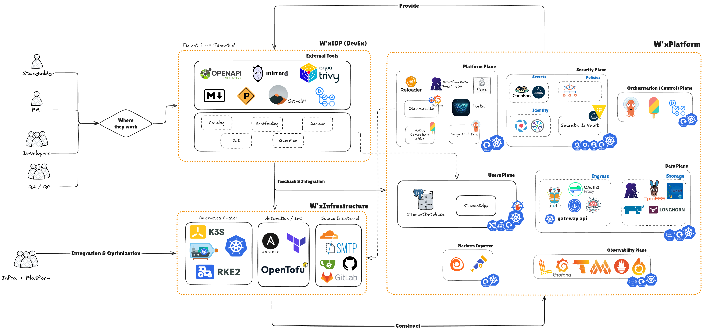

# Setup — installing W'xOps Core on a cluster

> Install the shared providers once, seed a connection token, install the packages, then apply a first resource. For what each resource does once it exists, see
> the [API reference](../api-reference/README.md).

**Table of Contents**
- [Setup — installing W'xOps Core on a cluster](#setup--installing-wxops-core-on-a-cluster)
  - [Prerequisites](#prerequisites)
    - [CLI (Command Line Interface)](#cli-command-line-interface)
    - [Platform \& Kubernetes Controller](#platform--kubernetes-controller)
  - [Platform dependencies, per package](#platform-dependencies-per-package)
  - [1 — Install providers once per cluster](#1--install-providers-once-per-cluster)
  - [2 — Seed a connection token](#2--seed-a-connection-token)
  - [3 — Install packages](#3--install-packages)
  - [(Optional) Kyverno-required guard — before any platform policy](#optional-kyverno-required-guard--before-any-platform-policy)
  - [4 — Apply a first resource](#4--apply-a-first-resource)
  - [Uninstalling](#uninstalling)
    - [Removing one category](#removing-one-category)
  - [Next](#next)

---

## Prerequisites



### CLI (Command Line Interface)

- The [`crossplane` CLI](https://docs.crossplane.io/latest/cli/), v2.3 or later (**NOTE:** Should match between `crossplane` Client and Server)
- `kubectl` pointed at a cluster with Crossplane v2.3 or later installed
- `pre-commit`, only if you will change this repository (see the [development guide](../../development-docs/development/README.md))

### Platform & Kubernetes Controller

- Crossplane and Controller: **(Supported)** [`Crossplane Runtime`](https://www.crossplane.io/), [`Crossplane Functions & Providers`](https://docs.crossplane.io/v2.4/learn/community-extension-projects/) (Explore more at [Upbound Marketplace](https://marketplace.upbound.io/))
- SCM: **(Supported)** `Github`, or [`Gitea (Self-hosted)`](https://about.gitea.com/). **(Future)** `GitLab`, [`GitLab CE (Self-hosted)`](https://docs.gitlab.com/topics/offline/quick_start_guide/)
- Identity (Authentication): **(Supported)** [`DexiDP`](https://dexidp.io/) (Explore and install with [Charts](https://github.com/wxops-idp/charts/tree/main/dexidp)), [`Pinniped`](https://pinniped.dev/) (Explore and install with [Charts](https://github.com/wxops-idp/charts/tree/main/pinniped))
- Secrets Management: **(Supported)** `OpenBao` (Recommended) or `Hashicorp Vault`
- Supply Chain Utilities: **(Supported)** [`CertManager`](https://cert-manager.io/), [`Stakater Reloader`](https://github.com/stakater/reloader), and [`External Secrets Operator`](https://external-secrets.io/latest/)
- Policies Management (Policies as Code): **(Supported)** [`Kyverno`](https://kyverno.io/docs/introduction/) v1.19 or later, in
  [high availability](https://kyverno.io/docs/guides/high-availability/) — see the [optional Kyverno-required guard](#optional-kyverno-required-guard--before-any-platform-policy)
- Database Managment (Created and Migration): **(Supported)** [`CNPG`](https://cloudnative-pg.io/)
- **(Option)** Gitops: **(Supported)** [`ArgoCD`](https://argo-cd.readthedocs.io/en/stable/)
- **(Option)** Observability: **(Supported)** `Grafana-CE Ecosystem (Grafana, Prometheus, Loki, Tempo, Pyroscope, and Alloy)`

## Platform dependencies, per package

W'xOps Core composes resources that other operators reconcile. Install what the packages you use need:

| Package | Needs in the cluster |
|---|---|
| `scm-connection`, `scm-repository`, `scm-oauth-app` | A reachable Gitea or GitHub host and an admin/API token, written to the secret store (step 2) |
| `platform-database-clusters` | CloudNativePG operator; External Secrets Operator with a Vault `ClusterSecretStore`; provider-sql (installed by step 1) |
| `tenant-database` | Everything `platform-database-clusters` needs, plus a cluster labelled for discovery; see [Required discovery labels](../api-reference/_archives/tenant-database.md#required-discovery-labels) |
| `tenant-app` | Only what the XR enables: cert-manager for `ingress.tls`, Traefik CRDs for `ingress`, Prometheus Operator CRDs for `monitoring`, Stakater Reloader for `reloader` |
| Darlane TTL enforcement **(Not Enforced)** | ~~Kyverno, plus `providers/policies/darlane-ttl.yaml`~~ |

## 1 — Install providers once per cluster

```bash
make providers
```

Installation is two steps, in this order:

```bash
make providers         # providers and functions, then waits for them to report Healthy
make provider-configs  # the ProviderConfigs, once their CRDs are served
```

A ProviderConfig cannot exist before its provider's CRDs are served, which is why they are separate targets rather than one apply. Override the wait with
`WAIT_TIMEOUT=600s` if image pulls are slow. A GitOps engine needs neither step: `providers/kustomization.yaml` is the all-at-once view, and Argo CD or Flux
retry until the CRDs appear.

Together they apply everything in `providers/`: `provider-opentofu`, `provider-kubernetes` (plus RBAC and a `ProviderConfig`), `provider-sql`,
`function-patch-and-transform`, `function-kcl`, `function-extra-resources`, and the OpenTofu `ProviderConfig`. **`provider-terraform` is archived**
(`providers/archive/`) and not applied: the only packages that ran on it (`gitea-*`) are themselves archived — see
[`providers/archive/README.md`](../../providers/archive/README.md).

> [!NOTE]
> **`make providers` is required before `make install`.**
> - **Dependency names.** Crossplane's `dependsOn` in `crossplane.yaml` can auto-install missing
>   dependencies, but under long names derived from the OCI path (for example
>   `crossplane-contrib-function-kcl` instead of `function-kcl`). Compositions reference the short
>   names set by `providers/*.yaml`, so auto-installed dependencies are not found.
> - **Provider configuration.** Providers like `provider-kubernetes` also need a `RuntimeConfig`, RBAC
>   and a `ProviderConfig`, which `dependsOn` cannot provide.
>
> `dependsOn` is a **version-constraint safety net**, not an installer.

## 2 — Seed a connection token

Every `scm-*` resource reads its vendor/token through one `XScmConnection`; the host token is the one secret Core cannot create itself. Write it to the secret
store `XScmConnection` renders from (`vault-platform` by default), property `token`, at `platform/scm/<connection-name>/credentials`:

```bash
export BAO_ADDR=https://openbao.example.com     # or a port-forward to the in-cluster service
bao login                                       # however your operators authenticate
bao kv put platform/scm/github-wxops-idp/credentials token="your-admin-or-pat-token"
```

See [Seeding a connection's token](../../examples/scm/connection/token-secret.md) for the full walkthrough, including what scope the token needs per vendor.

## 3 — Install packages

**Production** — pulls the Configuration packages pinned in `package/install/` from the OCI registry:

```bash
make install
```

**Development** — applies XRDs and Compositions straight from this checkout, with no registry:

```bash
make install-dev
```

`make install-dev` is for a disposable development cluster only. Against a cluster that already runs the packages, it overwrites package-managed XRDs and
Compositions and skips every release gate. Everything it applies carries `channel: nightly` (production packages ship `channel: stable`) — see
[Channels](../../development-docs/development/releasing.md#channels) for how an XR opts into either.

## (Optional) Kyverno-required guard — before any platform policy

> [!NOTE]
> **Optional — not required, and not shipped by W'xOps.** No package installs it or depends on it, and W'xOps does not test it. Apply it only if you want
> the extra assurance described below; every platform policy works without it.

Platform policies (`XPlatformPolicy`, and `XPolicy` after it) run inside Kyverno, in `Deny` with `failurePolicy: Fail`. While Kyverno serves, a write that
breaks a rule is refused, and a write Kyverno cannot check is refused too. One case slips through: when Kyverno shuts down **gracefully** — scaled to zero,
uninstalled, or its last admission replica stopped — it **deletes its own webhook configurations**, and until it serves again people's writes pass
unchecked (about two minutes in the [failure spike](../../development-docs/rfc/009-scm-personas.md#spike-and-acceptance-results-2026-11-04)).

**The first answer is Kyverno in high availability**, following Kyverno's [High Availability guide](https://kyverno.io/docs/guides/high-availability/) —
at least three admission-controller replicas, plus a PodDisruptionBudget so a drain never takes the last one:

```yaml
# Kyverno Helm values
admissionController:
  replicas: 3          # the minimum the HA guide supports; every platform policy runs here
backgroundController:
  replicas: 2
cleanupController:
  replicas: 2
reportsController:
  replicas: 0          # PolicyReports are not supported by W'xOps yet, so `mode: Audit` is not either
```

**The guard covers what HA cannot:** a deliberate scale-down or uninstall. It is one native `ValidatingAdmissionPolicy` — run by the API server itself, not
by Kyverno — whose parameter is Kyverno's own webhook configuration. While that configuration exists, the guard allows everything. When it disappears,
`parameterNotFoundAction: Deny` refuses **people's** writes until Kyverno is back: they pause instead of passing unchecked. Controllers, Crossplane, Argo
CD, Helm and cluster-admin are never matched — the same `scm-user` rule the platform policies use — so Kyverno can always be reinstalled.

Apply it **after Kyverno is running and before the first platform policy**:

```yaml
# Optional: pause SCM users' writes while Kyverno's webhooks are gone. Not shipped or required by W'xOps.
apiVersion: admissionregistration.k8s.io/v1
kind: ValidatingAdmissionPolicy
metadata:
  name: wxops-kyverno-required
spec:
  failurePolicy: Fail
  paramKind:
    apiVersion: admissionregistration.k8s.io/v1
    kind: ValidatingWebhookConfiguration
  matchConstraints:
    resourceRules:
      - apiGroups: ["*"]
        apiVersions: ["*"]
        operations: ["CREATE", "UPDATE", "DELETE", "CONNECT"]
        resources: ["*", "*/*"]
  matchConditions:
    # SCM users only — the same rule as the platform policies; list every org in your XPlatformPolicy `scmOrgs`
    - name: scm-user
      expression: "!request.userInfo.username.startsWith('system:') && request.userInfo.groups.exists(g, g.startsWith('<org>:'))"
    # never on access reviews, Pinniped's login APIs, events or leases — the platform policies' exclusions
    - name: not-excluded
      expression: >-
        !(request.resource.group in ['authentication.k8s.io', 'authorization.k8s.io', 'login.concierge.pinniped.dev', 'identity.concierge.pinniped.dev'])
        && !(request.resource.resource in ['events', 'leases'])
  validations:
    - expression: "true"
      message: "Kyverno is unavailable: writes by people are paused until it serves again"
---
apiVersion: admissionregistration.k8s.io/v1
kind: ValidatingAdmissionPolicyBinding
metadata:
  name: wxops-kyverno-required
spec:
  policyName: wxops-kyverno-required
  validationActions: [Deny]
  paramRef:
    name: <kyverno-validating-webhook-configuration>   # the one that serves policies.kyverno.io ValidatingPolicies
    parameterNotFoundAction: Deny
```

Before you rely on it, on a test cluster:

1. **Fill in `paramRef.name`.** List `kubectl get validatingwebhookconfigurations` and pick Kyverno's configuration that serves the `policies.kyverno.io`
   ValidatingPolicies; scale Kyverno's admission controller to zero and confirm that exact one disappears.
2. **Check that the API server accepts a `ValidatingWebhookConfiguration` as `paramKind`** — this guard is not yet verified on a cluster.
3. **Try both sides.** With Kyverno scaled to zero, an SCM user's write is refused with the guard's message, while a controller's or cluster-admin's write
   passes. Scale Kyverno back and the same user's write is decided by the platform policies again.

To remove it: `kubectl delete validatingadmissionpolicybinding wxops-kyverno-required` and `kubectl delete validatingadmissionpolicy wxops-kyverno-required`.

## 4 — Apply a first resource

```bash
kubectl apply -f examples/scm/connection/xr.yaml
kubectl apply -f examples/scm/repository/xr.yaml
kubectl get xscmrepositories
kubectl describe xscmrepository <name>
crossplane resource trace xscmrepository <name>   # the XR and everything it composed
```

Wait for `status.created` and `status.ready`; see [Reading status](../api-reference/README.md#reading-status).

## Uninstalling

```bash
make uninstall       # remove registry-installed Configuration packages
make uninstall-dev   # remove XRDs and Compositions applied by make install-dev
```

Delete XRs first, and read each Kind's deletion notes before you do. Kinds that hold data, like `XTenantDatabase`, keep it by default.

### Removing one category

`kubectl delete -k` works on a category the same way `kubectl apply -k` installs it (`package/scm/`, `package/auth/`, or `package/install/<group>/` for the registry
install). Order matters, because a Composition or XRD removed while XRs still use it leaves them with nothing to reconcile them:

1. **Delete the XRs of the category first**, and wait until they are gone (`kubectl get composite`). Their composed resources go with them: a `PushSecret` deletes its
   OpenBao record, while an `XScmTeam` or `XScmRepository` keeps the host object unless `retain: false` is set.
2. **Then delete the packages** — the Compositions and XRDs — with `kubectl delete -k package/<group>/` (or `make uninstall-dev`).
3. **Last, clear what is left over.** Crossplane never garbage-collects `CompositionRevision`s, so old ones remain; delete them by composition with
   `kubectl delete compositionrevision -l crossplane.io/composition-name=<composition>`.

Remove in dependency order across categories: `auth` reads `scm` (an `XOIDCConnector` reads its `XScmConnection` and `XScmTeam`s), so take `auth` out before `scm`.

## Next

- Ship an application end to end: [app onboarding](app-onboarding.md)
- Every Kind and what the reconcile loop does for it: [API reference](../api-reference/README.md)
- Build a portal on top: [portal integration](portal-integration.md)
